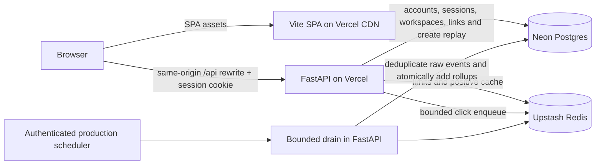

# URL Shortener — Design and Delivery Plan

Reviewed: 2026-10-25 · **Target design, not a production-readiness claim**

## Scope and decisions

Preserve the agreed stack and product: URL creation with generated/custom codes, expiry, first-party email/password accounts, personal and shared workspaces with role-based access, legacy token management for unowned links, and rich asynchronous click analytics. Host FastAPI and the Vite SPA as two Vercel projects in one repository.

| Concern | Choice | Tradeoff |
| --- | --- | --- |
| Backend | Python 3.12, FastAPI, uv; modular monolith | Simple deployment, shared resources between redirect/API/worker |
| Frontend | Bun, Vite, React/TypeScript, Tailwind v4, React Router | Static delivery; no server-rendered route status or private server secrets |
| Durable state | Neon Postgres, async SQLAlchemy, Alembic | Connection and analytics-storage budgets matter |
| Cache/limits/buffer | Upstash Redis | Network/command costs; not the durable source of link ownership |
| Codes | Random 5-character Base62, DB unique constraint and retries | Public identifiers, not authentication secrets; shorter space means more collision retries as volume grows |
| Accounts | First-party email/password, Argon2id hashes, opaque HttpOnly cookie sessions (30-day renewing with "Stay signed in", otherwise browser-session/24 hours), password change, session listing/revocation, self-service account deletion | No email verification, password reset, SSO or MFA in v1 |
| Tenancy | Personal workspace at signup plus shared workspaces and invitations | Every link is workspace-scoped; legacy unowned links remain reachable by token |
| RBAC | Owner > admin > member > viewer, enforced server-side; admins rename, owners delete or transfer ownership | Owner cannot be removed or self-demoted; admins cannot manage peers; personal workspaces cannot be deleted or transferred |
| Legacy management | Per-link 256-bit token, hash versioning, for unowned links only | Preserves pre-account links; workspace links never return a token |
| Create retries | Required UUIDv4 key, atomic Postgres encrypted replay for 24 hours | Replay key is also sensitive for legacy links; encryption/cleanup are necessary |
| Redirect cache | Positive-only cache-aside, max age 60 seconds | Bounded staleness, not immediate delete/revocation |
| Analytics | Durable Redis Stream consumer group, ACK-after-commit, reclaim and dead letters | Capture and enqueue remain best-effort; eventual results and explicit potential loss |
| UI state | Typed fetch client, cookie session, workspace selection from the command palette, per-link React state | Workspace changes must clear cached links and analytics |

No email verification, password reset, SSO/OAuth, MFA, billing, custom user domains, automatic malware fetching, multi-region writes or microservices in v1. QR codes (the browser-only [QR studio](system-design.md#qr-studio)) and bulk creation (CSV import) do exist.

## Current implementation

| Area | Exists now | Not yet implemented |
| --- | --- | --- |
| Backend | uv project, FastAPI app factory, async SQLAlchemy models and Alembic migrations, Neon/Upstash clients, RFC 9457 errors, email/password auth with cookie sessions, personal and shared workspaces, invitations, RBAC, password change with session revocation, workspace rename/delete/ownership transfer, idempotent create, redirect, tenant-scoped link management, durable stream analytics with ACK-after-commit/reclaim/dead letters and freshness status, bounded credential/replay/event cleanup, structured request logs, rate limits, 71 tests; auth and trust-recovery releases deployed on Vercel | Durable-stream release deployment, dashboards/alerting, backup automation, minute-level scheduler |
| Frontend | Login/signup/invite screens with "Stay signed in", a command palette (⌘K/Ctrl+K) for links, pages, actions and workspace switching, People and role management, Settings (password, sessions, workspace lifecycle, account deletion), role-aware create/detail/analytics flows with queue freshness, a UTM builder, analytics ranges up to a year with period comparison and CSV export, bulk link actions and CSV import/export, password-protected links, smart redirects by device and country, copy fallbacks, paste-to-shorten and keyboard shortcuts, typed API client, strict TypeScript, Tailwind v4, `bun test` unit tests and a Playwright E2E journey (`bun run e2e`, manual `e2e.yml` workflow); deployed on Vercel | Generated API types, automated a11y checks, E2E in push CI |
| Deployment | Two live Vercel projects on free `.vercel.app` hosts, same-origin `/api` rewrite so the session cookie stays first-party, environment configuration, authenticated daily cron, GitHub Actions CI for tests/lint/build | Custom domains, isolated preview environments |
| Security/operations | Argon2id passwords, opaque hashed session and invitation tokens, HttpOnly/SameSite=Lax/Secure-in-production cookies, Origin/Referer CSRF checks, exact-origin CORS with credentials, workspace scoping, owner row locks for destructive lifecycle actions, hashed legacy tokens, encrypted replay, safe JSON request logs, rate limits, documented backup/restore runbook | Metrics/dashboards/alerting, tracing, automated backup/restore drill, erasure/takedown workflow, credential rotation |

Local and integration checks pass against the live Neon/Upstash instances. Durable stream ingestion was smoke-tested locally on 2026-10-25 (enqueue → drain → committed row and rollup → ACK/delete → queue clear); the hosted API still runs the previous list consumer until that release is promoted. The hosted deployment was verified on 2026-10-25 for health/readiness, signup/login/logout, cookie flags, CSRF rejection, workspace creation and switching, link create/list/redirect/analytics, invitation preview/acceptance, role changes, owner protections, cross-tenant denial, password rotation with other-session revocation, session listing/revoke, workspace rename/transfer/delete and SPA deep links, in addition to the earlier create/redirect/token-management/analytics/cron smoke tests. A 45-check API smoke run and manual production browser checks of `/settings` passed. Retention cleanup, the invitation index, structured access logs and the session-ID migration are deployed; GitHub Actions CI is present but has not yet run on a pushed commit. The hosted evidence remains a smoke test: no load, availability, backup or recoverability claim is established.

## System context

- `backend/` is one Vercel root; `urlshortner/` is the other.
- The frontend rewrites `/api/:path*` to the backend, so browser requests are same-origin and the `shortly_session` cookie is first-party. The rewrite is a proxy, not a CORS bypass; the backend still checks the browser `Origin` on writes.
- Deployed hosts: web `https://shortlyyy-web.vercel.app`, short links `https://shortlyyy-go.vercel.app`, API `https://shortlyyy-api.vercel.app` (one project; both hosts redirect, so older `shortlyyy-api` links keep working). All are free `.vercel.app` names, not owned custom domains. The previous `shortly-saran-api`/`shortly-saran-web` projects remain deployed so links created before the move keep redirecting.
- Example custom origins remain `app.short.example`, `api.short.example`, `short.example`; they are placeholders, not provisioned domains.
- Local: frontend `http://localhost:5173`, API `http://127.0.0.1:8000`.
- Previews: exact allowed frontend origin, isolated sanitized Neon data and separate Upstash data/namespace. A copied production database is not safe preview isolation.
- Two backend hostnames still reach the same app; takedown and routing policy must cover both.
- The free Vercel plan allows only daily cron, so production sets `DRAIN_ON_READ=true` and drains a bounded batch of up to 500 queued stream events when analytics is read; the daily job is a backstop. This is eventual freshness, not the two-minute target.

## Critical invariants

1. Unique codes are enforced in Postgres, including deleted rows; codes from hard-deleted workspaces and accounts are kept in `retired_short_codes`; aliases are never reused.
2. Account passwords are stored only as Argon2id hashes; session and invitation tokens are stored only as SHA-256 digests in server-side rows.
3. Session cookies are HttpOnly, SameSite=Lax, Secure in production/preview, and never readable by the SPA. Cookie-authenticated writes reject browser origins outside `CORS_ORIGINS`.
4. Every workspace link read or write is scoped by membership; RBAC is enforced server-side on each request, not by hiding UI controls.
5. Link creation and its encrypted replay result commit together; a lost HTTP response does not create a second link. Workspace links return no management token; legacy unowned links replay theirs for 24 hours.
6. Cache invalidation cannot eliminate refill races. Anchor cache expiry to the original DB-read start and disclose the 60-second bound. Urgent malicious-link revocation requires verified edge denial or authoritative DB checks.
7. Authentication never falls back to cache or fails open. Redirect limiting may degrade; creation/management/analytics limiting does not.
8. Only newly inserted event IDs contribute rollup deltas, within the same transaction; ACK/delete follows commit. Worker overlap must be safe without relying on a lease.
9. Successful GET redirects may count clicks; HEAD/OPTIONS/errors do not. The awaited enqueue consumes a small latency budget; background persistence is asynchronous.
10. Rich analytics are in v1: referrer origin, device, country and heuristic bot flag. No permanent IP identifier or unique-visitor claim.
11. Analytics uses UTC date-only `[from, to)` intervals. Missing dates are zero-filled; 90-day breakdown truncation and uncertain freshness are visible.
12. Tokens, replay keys and cookies never appear in URLs, logs or query keys; all API responses are HTTP `no-store`. Workspace changes clear private UI state.
13. No claim of supported RPS, exact one-minute freshness or deployed functionality until measured and verified.

## Implementation plan

All future milestones require tests with the feature, not a final testing phase. Keep changes independently reviewable and avoid pre-creating unused abstractions.

| Phase | Deliverable | Exit criteria |
| --- | --- | --- |
| 0 — baseline | Existing scaffolds and this design | Local commands reproducible; target-vs-current differences documented |
| 1 — runtime + persistence | Production settings, offline schema generation, Neon models/Alembic, validated Vercel entrypoint | Isolated preview `/health`; TLS/pooling checked; migrations tested on disposable DB; debug/docs/CORS guarded |
| 2 — durable link vertical slice | Create/replay, generated/custom code, expiry, token management, direct DB GET/HEAD redirect | Collision + simultaneous-key + crash/replay tests; state/validation boundaries; token ciphertext never logged |
| 3 — fast and bounded redirect | Upstash limiter/cache/enqueue boundaries, operator block handling | Cache refill/delete races, Redis outage and bounded DB overload tested; legacy anonymous creation remains capped until durable global/per-code budgets exist |
| 4 — rich analytics | Durable stream consumer, incremental rollups, breakdown API, cleanup, authenticated scheduler | ACK/reclaim/DLQ and crash recovery tested; throughput/capacity and scheduler budget still need validation |
| 5 — usable frontend | Tailwind shell, auth pages, workspace switching, create/copy, management, rich analytics and people management | Typed contract, UTC date UX, retry behavior, private-cache clearing, keyboard/a11y and browser tests |
| 6 — accounts and tenancy | Email/password accounts, cookie sessions, password/session management, personal and shared workspaces, invitations, RBAC and workspace lifecycle | Verified locally and on the hosted deployment, including settings UI; email verification, reset and SSO remain out of scope |
| 7 — production release | CI gates, telemetry, budgets, privacy/takedown/erasure, restore/rollback, deployment | Measured load/latency/cost, supported cron plan, isolated previews, restore drill, public-host canaries; explicit deployment approval |

Frontend shell work may proceed after phase 1; API-dependent features use the versioned contract after phase 2. Do not add speculative KGS, distributed locks, multi-region replication or account infrastructure without a measured requirement.

## Before public launch

Resolve these deployment inputs during implementation (they do not block local scaffolding):

- Vercel plan/scheduler supports minute-level analytics jobs; Hobby daily cron does not meet the target. The current deployment uses daily cron plus bounded drain-on-read, which is a workaround rather than launch-grade freshness.
- Chosen region, domains, exact preview-origin pairing and verified nested Python entrypoint.
- Upstash stream/claim support is verified; eviction policy, byte/command limits and credential scope still need plan-specific confirmation.
- Expected sustained/burst traffic and monthly cost ceiling; explicit global create and per-code management-attempt budgets.
- Acceptable 60-second redirect staleness and an available urgent takedown control on all hosts.
- Data-retention/privacy obligations, abuse contact, erasure procedure, backup retention, measured recovery targets.

Suggested goals (not benchmarks): warm redirect p95 <100 ms, create p95 <400 ms, captured-event p95 freshness <2 minutes, redirect availability 99.9%. See [observability](backend/observability.md) for eligibility, cold-start reporting and request-based error budgets.

## Reading map

**Showcase:** [system design techniques, live signals and the QR studio](system-design.md).

**Backend:** [architecture](backend/architecture.md), [API](backend/api.md), [data model](backend/data-model.md), [codes/validation](backend/short-links.md), [cache/capacity](backend/caching-and-scale.md), [analytics](backend/analytics.md), [security](backend/security.md), [observability](backend/observability.md), [deployment](backend/deployment.md).

**Frontend:** [architecture](frontend/architecture.md), [data fetching](frontend/data-fetching.md), [UI/accessibility](frontend/ui-and-a11y.md), [performance](frontend/performance.md), [deployment](frontend/deployment.md), [end-to-end tests](frontend/deployment.md#end-to-end-tests).

**Decisions:** [two projects](adr/0001-two-vercel-projects.md), [data stack](adr/0002-data-stack.md), [code strategy](adr/0003-short-code-strategy.md), [analytics](adr/0004-async-analytics.md), [anonymous tokens](adr/0005-anonymous-management-tokens.md), [accounts and workspaces](adr/0006-accounts-and-workspaces.md).

API owns HTTP semantics, data model owns schema/transaction invariants, cache document owns staleness, and deployment owns vendor requirements. Keep ADRs and examples consistent with these authorities; diagrams do not override contracts.
