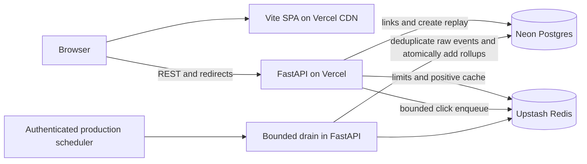

# URL Shortener — Design and Delivery Plan

Reviewed: 2026-10-23 · **Target design, not a production-readiness claim**

## Scope and decisions

Preserve the agreed stack and product: anonymous, accounts-ready URL creation with generated/custom codes, expiry, token-based management and rich asynchronous click analytics. Host FastAPI and the Vite SPA as two Vercel projects in one repository.

| Concern | Choice | Tradeoff |
| --- | --- | --- |
| Backend | Python 3.12, FastAPI, uv; modular monolith | Simple deployment, shared resources between redirect/API/worker |
| Frontend | Bun, Vite, React/TypeScript; planned Tailwind v4 + shadcn/ui | Static delivery; no server-rendered route status or private server secrets |
| Durable state | Neon Postgres, SQLAlchemy/Alembic planned | Connection and analytics-storage budgets matter |
| Cache/limits/buffer | Upstash Redis | Network/command costs; not the durable source of link ownership |
| Codes | Random 7-character Base62, DB unique constraint and retries | Public identifiers, not authentication secrets |
| Management | Per-link 256-bit token, hash versioning | Anonymous users must preserve their capability |
| Create retries | Required UUIDv4 key, atomic Postgres encrypted replay for 24 hours | Replay key is also sensitive; encryption/cleanup are necessary |
| Redirect cache | Positive-only cache-aside, max age 60 seconds | Bounded staleness, not immediate delete/revocation |
| Analytics | Bounded awaited enqueue, asynchronous idempotent SQL ingestion | Best-effort capture; eventual results and explicit potential loss |
| UI state | Generated OpenAPI types, TanStack Query with auth-scoped private caches | Must clear data when credentials change/are forgotten |

No accounts, teams, custom user domains, QR codes, bulk creation, automatic malware fetching, multi-region writes or microservices in v1. Accounts-ready means future additive migrations, not creating unused user tables today.

## Current implementation

| Area | Exists now | Not yet implemented |
| --- | --- | --- |
| Backend | uv project, app factory, typed basic settings, CORS middleware, `/health`, one test, Ruff | URLs, DB/migrations, Redis, auth, errors, rate limits, workers |
| Frontend | Default Vite React/TS scaffold, Bun lock, lint/build scripts | Product screens, router, strict TS enforcement, Tailwind/shadcn, queries, tests |
| Deployment | `tool.vercel.entrypoint` declaration | Verified Vercel entrypoint/build, projects, domains, env, schedule, cloud data |
| Security/operations | Basic environment files/ignore rules | Production debug/docs restrictions, exact noncredentialed CORS, observability, backup/erasure/takedown controls |

In particular, the scaffold still allows credentialed CORS/all methods and exposes interactive docs regardless of environment. A successful local health test does not establish deployability or production security.

## System context

- `backend/` is one Vercel root; `urlshortner/` is the other.
- Example web origin: `app.short.example`; API: `api.short.example`; redirect: `short.example`. These are placeholders, not provisioned domains.
- Local: frontend `http://localhost:5173`, API `http://127.0.0.1:8000`.
- Previews: exact allowed frontend origin, isolated sanitized Neon data and separate Upstash data/namespace. A copied production database is not safe preview isolation.
- Two backend hostnames still reach the same app; takedown and routing policy must cover both.

## Critical invariants

1. Unique codes are enforced in Postgres, including deleted rows; aliases are never reused.
2. Link creation and its encrypted replay result commit together; a lost HTTP response does not create a second link or lose management access on same-key retry.
3. Cache invalidation cannot eliminate refill races. Anchor cache expiry to the original DB-read start and disclose the 60-second bound. Urgent malicious-link revocation requires verified edge denial or authoritative DB checks.
4. Authentication never falls back to cache or fails open. Redirect limiting may degrade; creation/management/analytics limiting does not.
5. Only newly inserted event IDs contribute rollup deltas, within the same transaction; ACK/delete follows commit. Worker overlap must be safe without relying on a lease.
6. Successful GET redirects may count clicks; HEAD/OPTIONS/errors do not. The awaited enqueue consumes a small latency budget; background persistence is asynchronous.
7. Rich analytics are in v1: referrer origin, device, country and heuristic bot flag. No permanent IP identifier or unique-visitor claim.
8. Analytics uses UTC date-only `[from, to)` intervals. Missing dates are zero-filled; 90-day breakdown truncation and uncertain freshness are visible.
9. Tokens/replay keys never appear in URLs, logs or query keys; all API responses are HTTP `no-store`. Token removal clears private UI caches.
10. No claim of supported RPS, exact one-minute freshness or deployed functionality until measured and verified.

## Implementation plan

All future milestones require tests with the feature, not a final testing phase. Keep changes independently reviewable and avoid pre-creating unused abstractions.

| Phase | Deliverable | Exit criteria |
| --- | --- | --- |
| 0 — baseline | Existing scaffolds and this design | Local commands reproducible; target-vs-current differences documented |
| 1 — runtime + persistence | Production settings, offline schema generation, Neon models/Alembic, validated Vercel entrypoint | Isolated preview `/health`; TLS/pooling checked; migrations tested on disposable DB; debug/docs/CORS guarded |
| 2 — durable link vertical slice | Create/replay, generated/custom code, expiry, token management, direct DB GET/HEAD redirect | Collision + simultaneous-key + crash/replay tests; state/validation boundaries; token ciphertext never logged |
| 3 — fast and bounded redirect | Upstash limiter/cache/enqueue boundaries, operator block handling | Cache refill/delete races, Redis outage and bounded DB overload tested; no public anonymous creation before limits exist |
| 4 — rich analytics | Stream consumer, incremental rollups, breakdown API, cleanup, authenticated scheduler | Concurrent/replayed batch tests; crash recovery; 24-hour acceptance vs 90-day dedupe; throughput/capacity and scheduler budget validated |
| 5 — usable frontend | Tailwind/shadcn shell, create/copy/token backup, management, rich analytics | Typed contract, UTC date UX, storage failures, retry behavior, private-cache clearing, keyboard/a11y and browser tests |
| 6 — production release | CI gates, telemetry, budgets, privacy/takedown/erasure, restore/rollback, deployment | Measured load/latency/cost, supported cron plan, isolated previews, restore drill, public-host canaries; explicit deployment approval |

Frontend shell work may proceed after phase 1; API-dependent features use the versioned contract after phase 2. Do not add speculative KGS, distributed locks, multi-region replication or account infrastructure without a measured requirement.

## Before public launch

Resolve these deployment inputs during implementation (they do not block local scaffolding):

- Vercel plan/scheduler supports minute-level analytics jobs; Hobby daily cron does not meet the target.
- Chosen region, domains, exact preview-origin pairing and verified nested Python entrypoint.
- Upstash stream/claim/script support, eviction policy, byte/command limits and credential scope.
- Expected sustained/burst traffic and monthly cost ceiling; explicit global create and per-code management-attempt budgets.
- Acceptable 60-second redirect staleness and an available urgent takedown control on all hosts.
- Data-retention/privacy obligations, abuse contact, erasure procedure, backup retention, measured recovery targets.

Suggested goals (not benchmarks): warm redirect p95 <100 ms, create p95 <400 ms, captured-event p95 freshness <2 minutes, redirect availability 99.9%. See [observability](backend/observability.md) for eligibility, cold-start reporting and request-based error budgets.

## Reading map

**Backend:** [architecture](backend/architecture.md), [API](backend/api.md), [data model](backend/data-model.md), [codes/validation](backend/short-links.md), [cache/capacity](backend/caching-and-scale.md), [analytics](backend/analytics.md), [security](backend/security.md), [observability](backend/observability.md), [deployment](backend/deployment.md).

**Frontend:** [architecture](frontend/architecture.md), [data fetching](frontend/data-fetching.md), [UI/accessibility](frontend/ui-and-a11y.md), [performance](frontend/performance.md), [deployment](frontend/deployment.md).

**Decisions:** [two projects](adr/0001-two-vercel-projects.md), [data stack](adr/0002-data-stack.md), [code strategy](adr/0003-short-code-strategy.md), [analytics](adr/0004-async-analytics.md), [anonymous tokens](adr/0005-anonymous-management-tokens.md).

API owns HTTP semantics, data model owns schema/transaction invariants, cache document owns staleness, and deployment owns vendor requirements. Keep ADRs and examples consistent with these authorities; diagrams do not override contracts.
