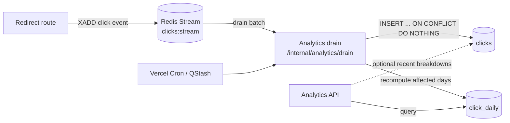

# Analytics Pipeline

Status: target design · Related: [Caching and scaling](caching-and-scale.md) · [ADR 0004](../adr/0004-async-analytics.md)

## Goals

- Never make a user wait for analytics writes.
- Capture enough detail for useful per-link reporting: time, referrer, device, country, and bot classification.
- Survive duplicate delivery without double counting.
- Avoid storing raw IP addresses.
- Keep the pipeline operable with the existing Upstash and Neon services.

## Design at a glance



The redirect path performs at most one best-effort `XADD`. All parsing, enrichment, and persistence happen in the drain.

## Event capture

At redirect time, before returning `302`, the API builds:

```json
{
  "event_id": "018f4f4e-8d9a-7c3b-9d2e-1a2b3c4d5e6f",
  "url_id": 42,
  "short_code": "sysdesign",
  "clicked_at": "2026-10-23T12:00:00.123Z",
  "ip_hash": "9f2c4e71a0b3d5e8",
  "user_agent": "Mozilla/5.0 ...",
  "referer": "https://news.ycombinator.com/item",
  "country": "US",
  "device_type": "desktop",
  "is_bot": false
}
```

```text
XADD clicks:stream MAXLEN ~ 1000000 * payload '<json>'
```

Rules:

- `event_id` is a UUID generated in the function. It is the idempotency key.
- `clicked_at` comes from the injected UTC clock.
- `short_code` is denormalized for debugging; `url_id` is the authoritative reference.
- The event is appended after the link is validated, but before the response is returned.
- If `XADD` fails or times out (200 ms), the redirect still succeeds and `analytics.enqueue_failed` is incremented. No synchronous fallback write is attempted.
- The stream is capped at roughly one million entries as a safety valve. The cap is not the retention policy; the drain is.

## Field derivation

### Client IP

Use the platform-provided client IP from Vercel's forwarded headers. Do not trust a client-supplied `X-Forwarded-For` chain beyond the platform-trusted value.

```python
ip_hash = hmac.new(
    key=settings.analytics_ip_salt.encode(),
    msg=client_ip.encode(),
    digestmod=hashlib.sha256,
).digest()[:16]
```

- Store 16 bytes (128 bits) of the HMAC, hex-encoded in the stream.
- Never store the raw IP.
- Rotate the salt quarterly; old and new hashes are intentionally uncorrelatable.
- The salt is a production secret.

### Referrer

- Parse the `Referer` header.
- Keep scheme, host, and path only; strip query and fragment.
- Truncate to 2048 characters.
- Treat the short domain itself as a self-referral and store `null`.
- Invalid URLs become `null`; never log the raw invalid value.

### User agent and device

- Truncate the user agent to 512 characters.
- Classify with a lightweight UA parser into `desktop`, `mobile`, `tablet`, `bot`, or `unknown`.
- Mark known crawlers and link-preview bots with `is_bot = true`.
- Bots are retained for totals but excluded from `human_clicks`.

### Country

- Use Vercel's geo header (`x-vercel-ip-country`) when present.
- Store ISO 3166-1 alpha-2 only. Do not store city, latitude, or longitude.
- Missing or invalid values become `null`.

## Stream consumption

### Endpoint

```http
GET /internal/analytics/drain
Authorization: Bearer $CRON_SECRET
```

- The route is not part of the public API and must reject everything without the secret.
- It is idempotent and safe to retry.
- It returns a summary: `{"processed": 500, "inserted": 498, "acknowledged": 500, "duration_ms": 120}`.

### Consumer group

```text
group: analytics-drain
consumer: drain-{function_instance_id}
```

- `XREADGROUP` reads up to 500 events at a time.
- `XACK` after the database transaction commits.
- Pending entries older than five minutes are reclaimed with `XAUTOCLAIM`, so a crashed invocation does not strand events.
- A Redis lock (`SET analytics:drain:lock NX PX 55000`) prevents overlapping drains when cron and a manual run coincide.

### Batch transaction

For each batch:

1. Parse events, discarding malformed payloads with a metric.
2. Insert with `ON CONFLICT (event_id) DO NOTHING` and capture which rows were inserted.
3. Collect distinct `(url_id, day)` pairs from inserted rows.
4. Recompute those daily rollups from raw events.
5. Commit.
6. `XACK` the batch.
7. Continue until the stream is empty or a 20-second time budget is reached.

Inserting and rolling up in one transaction means an acknowledged batch is fully reflected in the read model.

### Idempotent rollups

Rollups are recomputed, not incremented:

```sql
INSERT INTO click_daily (url_id, day, clicks, human_clicks, bot_clicks)
SELECT
    url_id,
    (clicked_at AT TIME ZONE 'UTC')::date AS day,
    count(*) AS clicks,
    count(*) FILTER (WHERE NOT is_bot) AS human_clicks,
    count(*) FILTER (WHERE is_bot) AS bot_clicks
FROM clicks
WHERE (url_id, (clicked_at AT TIME ZONE 'UTC')::date) IN (...)
GROUP BY 1, 2
ON CONFLICT (url_id, day) DO UPDATE SET
    clicks = EXCLUDED.clicks,
    human_clicks = EXCLUDED.human_clicks,
    bot_clicks = EXCLUDED.bot_clicks;
```

A retried batch recomputes the same values. Raw events must exist for every day being recomputed; retention is 90 days, so recomputation is limited to that window. Older rollups are final.

## Scheduling

Preferred: Vercel Cron every minute (requires a plan that supports minute-level schedules).

```json
{
  "crons": [
    {
      "path": "/internal/analytics/drain",
      "schedule": "* * * * *"
    }
  ]
}
```

- Vercel sends `Authorization: Bearer $CRON_SECRET` when the environment variable is configured.
- On plans limited to daily cron, use an Upstash QStash schedule every minute, or accept lower freshness.
- A daily cleanup job handles raw retention and expired links.
- Never expose the drain endpoint without authentication, even though it is idempotent.

## Analytics read model

```http
GET /api/v1/links/{code}/analytics
X-Management-Token: ...
```

V1 reads `click_daily` for the requested range. Because the drain updates today's row, analytics are eventually consistent within one interval.

Future additive fields:

- `top_referers`: aggregate over raw events within the 90-day retention window.
- `top_countries`: same.
- `devices`: same.
- `unique_visitors`: approximate using a privacy-preserving sketch; not exact visitor counts.

Query limits:

- Default range: 30 days.
- Maximum range: 366 days.
- Interval: day only in v1.

## Failure handling

| Failure | Behavior |
| --- | --- |
| `XADD` timeout/failure | Redirect succeeds; event dropped; metric and alert |
| Drain crashes before commit | Events remain pending; reclaimed after five minutes |
| Duplicate stream delivery | `event_id` uniqueness ignores the duplicate |
| Postgres unavailable | Batch retries next run; pending entries retained |
| Malformed event | Skipped, counted, acknowledged so it cannot poison the pipeline |
| Stream near capacity | Oldest entries may be trimmed; alert on stream length |
| Cron missed | Backlog drains on the next run; analytics lag increases |

## Privacy

- No cookies, fingerprinting, or cross-site identifiers.
- Raw IPs are never stored or logged.
- Referrer query strings are stripped because they can contain tokens or personal data.
- Geo is country-level only.
- Raw events are retained for 90 days; rollups for 2 years.
- Document the privacy policy and provide a deletion path when accounts ship.
- Honor Global Privacy Control where required by treating it as a signal to skip `ip_hash` storage; aggregate counts remain.

## Observability

Track:

- Stream length and oldest unacknowledged event age.
- Drain duration, batch size, inserted and duplicate counts.
- Parse failures by reason.
- Rollup recomputation rows.
- Time since last successful drain.
- Analytics API p95 and error rate.

Alert when stream length exceeds 100,000, pending age exceeds 10 minutes, or the drain has not succeeded in 15 minutes. See [observability.md](observability.md).

## Rollout plan

1. Add `clicks` and `click_daily` migrations.
2. Add event construction and `XADD` behind a feature flag.
3. Add the drain endpoint and run it manually against a preview stream.
4. Enable the cron schedule.
5. Add the analytics API and frontend chart.
6. Add retention and cleanup jobs after the first full week of data.
