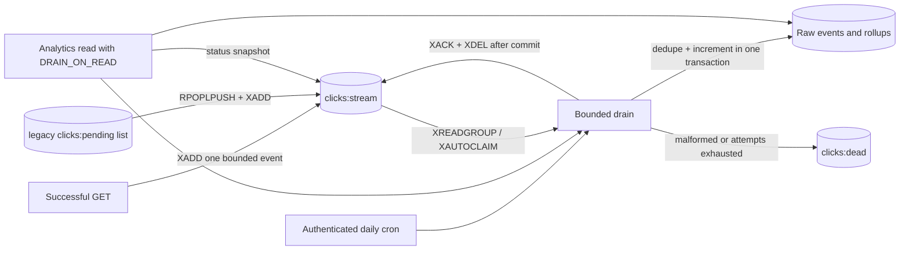

# Analytics Pipeline

Status: implemented with a Redis Streams consumer group, ACK-after-commit, stale-message reclaim, a dead-letter stream, drain-on-read and daily cron · [Data model](data-model.md) · [ADR 0004](../adr/0004-async-analytics.md)

## Delivery contract

Click capture is best-effort and asynchronous. Once an event is accepted into Redis, ingestion is **at-least-once**: it is acknowledged only after its database transaction commits, and unacknowledged events are reclaimed and retried. The database deduplicates by `event_id`, so retries cannot double-count.

- The redirect awaits one bounded `XADD`; a Redis error or timeout still returns the `302`.
- A worker crash, timeout, or failed commit leaves the batch pending. Another drain reclaims it after an idle threshold.
- Malformed payloads and messages that exceed the delivery budget move to a bounded dead-letter stream instead of blocking the queue.
- Enqueue failure, Redis data loss, provider eviction, and capacity exhaustion can still lose events. No end-to-end exactly-once, lossless, unique-visitor or exact-human-click guarantee is offered.
- `HEAD`, `OPTIONS`, `404`, `410`, `429` and failed redirects never emit clicks. Link-preview GETs can count but are classified best-effort as bots.



## Event capture

The redirect constructs and classifies the event before enqueue:

```json
{
  "event_id": "8f14e45f-ea4d-4b1e-9c1a-5f0e2d7a6b31",
  "url_id": 42,
  "clicked_at": "2026-10-23T12:00:00.123Z",
  "referer_origin": "https://example.com",
  "country": "US",
  "device_type": "desktop",
  "is_bot": false
}
```

- Create one UUIDv4 event ID per successful GET and timestamp it server-side. There is no enqueue retry on the hot path.
- Keep only the referrer **origin** after HTTP(S) parsing: remove userinfo, path, query and fragment. Missing, invalid or self-referring origins become null.
- Country is a validated two-letter platform value; untrusted local headers are not accepted as geo evidence.
- The user agent is classified at redirect time and **not** stored in the queue or database. Persisted fields are the coarse `device_type` and `is_bot` flag.
- No IP/hash is included in the event. IP is used transiently for rate limiting only. There is no persistent visitor identifier.
- Enqueue uses the normal Redis client timeout and is wrapped so a Redis error never fails a valid redirect. A timeout may mean accepted-or-lost, not certain loss. Do not fall back to SQL or untracked background tasks.
- Device/bot classification is heuristic. Bots are detected by user-agent markers, not reputation data.

## Stream keys and consumer group

| Key | Purpose |
| --- | --- |
| `clicks:stream` | Append-only event stream. Producers use `XADD`; the consumer group uses `XREADGROUP`. |
| `analytics` | Single consumer group over `clicks:stream`, created on demand with `MKSTREAM`. |
| `clicks:dead` | Bounded dead-letter stream (`MAXLEN ~ 10,000`) for poison and exhausted events. |
| `clicks:pending` | Legacy list from pre-stream deployments. Emptied by the migration path. |
| `clicks:pending:processing` | Migration parking list; entries are recoverable if the process dies mid-move. |

- Consumers are named per process (`host-pid-random`) so concurrent drains claim their own messages.
- The production deployment normally runs one drain at a time (cron or analytics read), but the protocol is safe with overlapping consumers: each message is owned by one consumer, and idempotent persistence makes handovers harmless.
- `XACK` does not free stream memory. Acknowledged messages are also `XDEL`-ed in the same pipeline. Unacknowledged messages remain stored until claimed, retried, or dead-lettered.
- No time-based `XTRIM` is used because it could discard still-pending payloads.

## Buffer and drain

`DRAIN_ON_READ=true` drains up to 500 events before an analytics query. This keeps the free-plan deployment reasonably fresh between daily cron runs; it is not a guaranteed freshness bound. The daily cron drains up to 5,000 events.

Each drain performs:

1. **Ensure the consumer group** with `XGROUP CREATE ... MKSTREAM`; `BUSYGROUP` is treated as success.
2. **Migrate legacy list entries** (bounded at 200): recover anything parked in `clicks:pending:processing`, then `RPOPLPUSH` from `clicks:pending` into the processing list, `XADD` it to the stream, and `LREM` it. A crash at any point leaves the entry recoverable; replay duplicates are deduplicated by `event_id`.
3. **Reclaim stale pending messages** (bounded at 100): read `XPENDING` details. Entries idle at least `ANALYTICS_CLAIM_MIN_IDLE_SECONDS` (default 60) are candidates. Candidates whose delivery count reached `ANALYTICS_MAX_ATTEMPTS` (default 5) are dead-lettered with their last payload and acknowledged. The rest are claimed with `XAUTOCLAIM` and processed normally.
4. **Read new messages** with `XREADGROUP` in batches of 200, up to the invocation budget, and process/acknowledge each batch before reading the next.
5. **Sort valid events** by `(url_id, day)` before upsert to reduce deadlock risk between overlapping drains.

Important Upstash detail: the ranged `XPENDING` form takes the count positionally (`XPENDING key group - + 100`); it does not accept a `COUNT` keyword.

## Transactional ingestion

For each batch:

1. Parse and validate the envelope (`event_id`, `url_id`, `clicked_at`). Invalid payloads go to `clicks:dead` with reason `malformed_event`.
2. Insert raw rows with `ON CONFLICT (event_id) DO NOTHING RETURNING url_id, clicked_at, is_bot`.
3. Aggregate **only the returned rows** by `(url_id, UTC day)`.
4. Atomically increment daily totals by those deltas and commit raw events and rollups together.
5. **After** the commit succeeds, pipeline `XACK` and `XDEL` for the batch. On a database failure, roll back and leave the batch pending; it is retried after the idle threshold.
6. If the acknowledgement itself fails, the committed rows remain and the message is reclaimed later; `event_id` dedup prevents double counts.

Illustrative single-event SQL (bind parameters, execute within the batch transaction):

```sql
WITH inserted AS (
    INSERT INTO clicks (event_id, url_id, clicked_at, referer_origin, country, device_type, is_bot)
    VALUES (:event_id, :url_id, :clicked_at, :referer_origin, :country, :device_type, :is_bot)
    ON CONFLICT (event_id) DO NOTHING
    RETURNING url_id, clicked_at, is_bot
)
INSERT INTO click_daily (url_id, day, clicks, human_clicks, bot_clicks)
SELECT url_id, (clicked_at AT TIME ZONE 'UTC')::date, count(*),
       count(*) FILTER (WHERE NOT is_bot), count(*) FILTER (WHERE is_bot)
FROM inserted
GROUP BY url_id, (clicked_at AT TIME ZONE 'UTC')::date
ON CONFLICT (url_id, day) DO UPDATE SET
    clicks = click_daily.clicks + EXCLUDED.clicks,
    human_clicks = click_daily.human_clicks + EXCLUDED.human_clicks,
    bot_clicks = click_daily.bot_clicks + EXCLUDED.bot_clicks;
```

The implementation uses SQLAlchemy upserts grouped in the same transaction rather than this exact statement; the invariant is what matters.

## Dead letters

`clicks:dead` entries contain `source_id`, `reason`, a payload preview truncated to 1,000 characters, and `failed_at`. Reasons:

- `malformed_event`: JSON parse or required-field validation failed.
- `max_attempts_exceeded`: the message was delivered/claimed `ANALYTICS_MAX_ATTEMPTS` times without a successful commit.

Dead letters are diagnostic, not replayable automatically. Inspect with `XRANGE clicks:dead - + COUNT 20`. After fixing a systemic cause, an operator can replay a payload by `XADD`-ing it back to `clicks:stream` (dedup keeps replay safe) and should then acknowledge/delete the dead entry. Never bulk-replay without checking that the underlying issue is resolved.

## Freshness and status

`GET /internal/analytics/status` (cron-authenticated) returns an operational snapshot:

```json
{
  "redis_ok": true,
  "consumer": "host-123-4f2a1c",
  "stream_depth": 0,
  "pending": 0,
  "lag": 0,
  "oldest_pending_age_seconds": null,
  "dead_letter_depth": 0,
  "legacy_pending": 0,
  "legacy_in_flight": 0,
  "generated_at": "2026-10-25T11:10:15Z"
}
```

- `stream_depth` includes pending/unacknowledged entries, because acknowledged entries are deleted.
- `pending` is `XPENDING` count for the group; `lag` comes from `XINFO GROUPS`.
- `oldest_pending_age_seconds` is the idle time of the oldest pending entry.
- Redis failures return `redis_ok: false` with null metrics instead of failing the request.

The analytics response embeds the same snapshot as `freshness` (`pending_events`, `lag_events`, `oldest_pending_seconds`, `dead_letter_events`, `captured_at`, `redis_ok`). The browser shows “Ingestion queue is clear,” the queued count and oldest age, or an unavailable warning. Freshness describes the shared pipeline, not proof that every individual click was captured.

## Rollups and breakdowns

- Daily rollups drive totals and the zero-filled series for any range retained (two years).
- Breakdowns come from raw events in the last 90 UTC days, including today, intersected with the requested `[from, to)`.
- Top referrer origins and countries are limited to 10; devices are limited to the observed categories (at most four). Unknown/null is a real category, not “direct traffic.”
- `last_processed_at` is the newest `ingested_at` among retained raw events for the link, or null. It is not a queue-health proof.
- `data_through` remains **null in V1**: global capture is still best-effort at enqueue, so complete event-time coverage cannot be certified.
- The API reports the effective breakdown range and `truncated`; no raw overlap returns null boundaries and empty arrays while rollup totals remain available. Reads sum rollups; they never add raw-event counts to totals.

## Retention and cleanup

The `internal/maintenance` cron runs bounded retention statements in one transaction:

- Expired user sessions, deleted in bounded batches.
- Expired, accepted, or revoked workspace invitations, deleted in bounded batches.
- Create-replay rows whose `expires_at` has passed.
- Raw clicks older than the configured 90-day cutoff (00:00 UTC on `today_utc - 89 days`).
- Daily rollups older than the configured 730-day cutoff.

Deleting a link cascades its raw events, rollups and replay rows. Analytics reads also enforce the visible windows, so delayed cleanup does not expand the API's reported range. Monitor cleanup duration and row counts; a single unbounded `DELETE` can become expensive as the corpus grows. Dead-letter trimming is bounded by `MAXLEN ~ 10,000` and needs no maintenance job.

## Failure behavior

| Failure | Behavior |
| --- | --- |
| Redis enqueue timeout/error | Redirect still succeeds; click may be lost |
| Redis unavailable during drain | Drain reports `redis_ok: false`; events remain buffered if Redis returns |
| Worker crash after read, before commit | Messages stay pending; reclaimed after the idle threshold |
| Database failure during persist | Transaction rolls back; batch stays pending and is retried |
| Commit succeeds, ACK fails | Message is reclaimed; dedup prevents double counts |
| Malformed stream entry | Moved to `clicks:dead`, then acknowledged |
| Repeated failure (5 attempts) | Moved to `clicks:dead` with reason `max_attempts_exceeded` |
| Legacy list migration crash | Entry remains in the processing list and is recovered |
| Missed cron | Drain-on-read provides limited catch-up; freshness is not guaranteed |
| Duplicate delivery/replay | Insert conflict; no duplicate counts or rollup deltas |

## Test and capacity gates

Covered by `backend/tests/test_analytics_streams.py` and existing helper tests:

- classification and referrer-origin parsing;
- ACK only after a successful commit, and no ACK after a failed commit;
- malformed payload dead-lettering;
- exhausted-attempt dead-lettering;
- stale pending reclaim versus fresh pending;
- lossless legacy migration and in-flight recovery;
- status snapshot parsing, missing-group handling and Redis-down degradation;
- Redis transport/HTTP/JSON failures becoming `RedisError` so redirect capture fails open;
- fail-open capture;
- rollup deltas from inserted rows only.

Capacity work must measure enqueue latency, drain throughput, database transaction time, pending age and stream growth under an authorized isolated load test. Do not claim lossless ingestion or a two-minute freshness bound on the current free-plan deployment. See [observability](observability.md) for alert thresholds and [deployment](deployment.md) for backup/restore.
