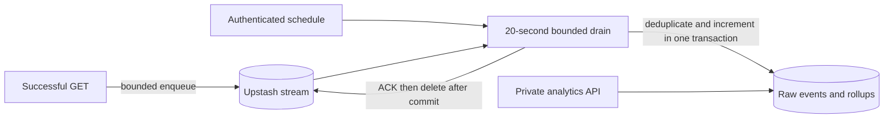

# Analytics Pipeline

Status: target design · [Data model](data-model.md) · [ADR 0004](../adr/0004-async-analytics.md)

## Delivery contract

V1 captures rich click events best-effort, buffers them in Upstash Redis Streams, and ingests into Neon asynchronously. The redirect **awaits one bounded enqueue attempt**; parsing the UA, SQL inserts and aggregation happen later. This removes SQL writes from the hot path, not all analytics latency.

- Capture can fail or time out; a redirect must still succeed.
- Retained accepted events may be delivered repeatedly. Database deduplication prevents duplicate counting, including overlapping workers.
- Buffer overflow, prolonged outages, poison events and events outside the acceptance horizon may lose analytics.
- No end-to-end exactly-once, lossless, unique-visitor, or exact-human-click guarantee.



## Event capture

Illustrative versioned payload:

```json
{
  "v": 1,
  "event_id": "8f14e45f-ea4d-4b1e-9c1a-5f0e2d7a6b31",
  "url_id": 42,
  "clicked_at": "2026-10-23T12:00:00.123Z",
  "user_agent": "Mozilla/5.0",
  "referer_origin": "https://example.com",
  "country": "US"
}
```

- Create one UUIDv4 event ID per successful GET; preserve it if a producer retry is ever introduced. V1 does not retry enqueue on the hot path.
- HEAD, OPTIONS, 404, 410, 429 and failed redirects do not emit clicks. Link-preview GETs can count but are classified best-effort as bots.
- Cap serialized event size (4 KiB), UA at 512 characters, origin at 2048; validate before enqueue and at ingestion.
- Keep only the referrer **origin** after HTTP(S) parsing: remove userinfo, path, query and fragment. Missing, invalid or self-referring origins become null. Paths can contain personal data too.
- Country is a validated two-letter platform value; untrusted local headers are not accepted as geo evidence.
- No IP/hash in the event. IP is used transiently for rate limiting only. No persistent visitor identifier is necessary for the chosen metrics.
- A 50 ms application deadline bounds enqueue including connection acquisition. Timeout may mean accepted-or-lost, not certain loss. Do not fall back to SQL or untracked background tasks.
- Worker classifies device and bot flag, discards raw UA, and persists only coarse dimensions. Classification is heuristic.

## Buffer limits and recovery

Environment-specific stream/group keys; initialize the consumer group with `0-0` to include existing backlog, tolerating only the documented already-exists response. Redis capabilities must pass an integration test against the selected Upstash service before rollout.

- Read up to 500 entries and a bounded total byte budget per batch; tune from measurements.
- Reclaim pending entries older than five minutes with a supported claim operation; verify ownership can be recovered after a crash.
- Each invocation spends at most 20 seconds taking/processing batches under a 30-second function limit. Do not start a batch without commit/ACK headroom.
- An optional lease reduces overlap but does not establish correctness; if used, release only the caller's token atomically, and tolerate lease expiry.
- ACK only after DB commit. **XACK does not remove stream entries**: subsequently XDEL committed IDs. Use a supported atomic ACK/delete sequence for the single consumer group, and bounded cleanup for acknowledged leftovers after crashes.
- Adding another consumer group changes deletion safety and requires redesign; do not delete data another group still needs.

Set a maximum event count **and byte budget**, and age-limit unprocessed data to 24 hours. A tentative million-entry cap must fit the selected plan; at 1,000 events/s it covers only 16.7 minutes, not a day. `MAXLEN ~` can exceed its target and trim unread/pending payloads; it is a lossy safety cap, not durable retention. Alert on capacity, deleted-pending IDs and the oldest **unread as well as pending** entry.

## Transactional ingestion

For valid events no older than 24 hours and no more than five minutes ahead of worker time:

1. Validate event version and fields; ensure `url_id` exists. Handle erased/deleted/blocked destinations according to retention policy; never poison the entire batch with a missing foreign key.
2. Begin a DB transaction; insert events with `ON CONFLICT (event_id) DO NOTHING RETURNING url_id, clicked_at, is_bot`.
3. Aggregate only returned rows by `(url_id, UTC day)`.
4. Atomically increment daily totals from these deltas; commit both raw events and totals together.
5. ACK/delete the stream entries. On failure before commit retry later; on failure after commit redelivery inserts nothing and does not change totals.

Illustrative single-event SQL (bind parameters, execute within the batch transaction):

```sql
WITH inserted AS (
    INSERT INTO clicks (event_id, url_id, clicked_at, referer_origin, country, device_type, is_bot)
    VALUES (:event_id, :url_id, :clicked_at, :referer_origin, :country, :device_type, :is_bot)
    ON CONFLICT (event_id) DO NOTHING
    RETURNING url_id, clicked_at, is_bot
)
INSERT INTO click_daily (url_id, day, clicks, human_clicks, bot_clicks)
SELECT url_id, (clicked_at AT TIME ZONE 'UTC')::date,
       count(*), count(*) FILTER (WHERE NOT is_bot), count(*) FILTER (WHERE is_bot)
FROM inserted
GROUP BY 1, 2
ORDER BY 1, 2
ON CONFLICT (url_id, day) DO UPDATE SET
    clicks = click_daily.clicks + EXCLUDED.clicks,
    human_clicks = click_daily.human_clicks + EXCLUDED.human_clicks,
    bot_clicks = click_daily.bot_clicks + EXCLUDED.bot_clicks;
```

Multi-event batches use the same rule and ordered upserts. This is idempotent because duplicate events contribute zero delta. Recomputing full-day totals and overwriting them from concurrent snapshots is unsafe even if a Redis lock usually prevents overlap.

Discard unsupported/malformed/too-old payloads into a **bounded redacted diagnostic record** (event/stream ID, reason, version, no raw header/token/URL contents), then ACK/delete and count them. Do not retry poison entries forever. Keep diagnostics at most seven days and cap size/count. Retry transient DB faults without acknowledging valid entries; if diagnostic storage is unavailable, emit a privacy-safe counter/log and still discard a permanently invalid entry.

Raw event retention is 90 UTC days and rollups two years. Reject older-than-24-hour events before insert so a replay cannot bypass a dedupe row already removed by retention. Run retention before public launch, not after accumulating sensitive data.

## Scheduling and authentication

Vercel production cron calls GET `/internal/analytics/drain` with `Authorization: Bearer $CRON_SECRET`; **`CRON_SECRET` is unprefixed**. Reject missing configuration and wrong headers with no side effects. Return only counts, duration and lag diagnostics; use `no-store`.

- Pro/Enterprise currently support every-minute schedules; Hobby allows daily schedules and rejects `* * * * *` during deployment.
- Cron uses UTC and production deployments; ordinary previews need explicitly authorized manual tests.
- Runs may be missed/duplicated; failures are not automatically retried by cron. Pending-entry reclamation and alerts are mandatory.
- If minute-level Vercel cron is unavailable, validate an external scheduler such as QStash before choosing it. Its method/auth/signature and retry semantics need their own integration; it is not automatically compatible with the Vercel GET/bearer route.
- Daily freshness does not satisfy the v1 two-minute target. Resolve the scheduler budget before shipping analytics.

Run GET `/internal/maintenance` daily with the same production auth boundary. Batch cleanup of replay records, raw events, rollups and diagnostics within a deadline; it does not toggle expired-link active state.

## Read model and freshness

The [API](api.md#analytics) defines date-only UTC half-open ranges, zero-filled rollups, top referrer origins/countries, device categories, and clipped 90-day breakdowns. Use a consistent DB snapshot so counts do not change between related queries.

`last_processed_at` is per-link latest retained raw-event ingestion time; no events means null. `data_through` is null in v1 because capture loss prevents a completeness claim. Do not infer pipeline health from one event timestamp. Operator metrics separately track successful drains, unread lag, pending age, enqueue outcomes and backlog.

Target p95 admitted-event freshness under two minutes in healthy operation; five-minute reclaim and backlog make this an SLO, not a per-request guarantee. Expose partial/stale states in the UI.

## Acceptance and operational tests

- Duplicate event within a batch, across batches, and across concurrent drains increments exactly once.
- Crash before insert, before commit, after commit/before ACK, and after ACK/before deletion; no acknowledged valid event lacks its DB effects.
- Lost lease, overlapping workers, recovery of pending entries, unknown event version, foreign-key deletion race, trim of a pending ID, and retention-boundary replay.
- Measured drain throughput greater than sustained production capture with catch-up headroom; a batch size alone proves no throughput.
- Alert at ten minutes of oldest unprocessed age, fifteen minutes without a successful drain, and before byte/entry caps. Record dropped/uncertain enqueue outcomes separately from known malformed drops.

Official scheduling references: [Cron management](https://vercel.com/docs/cron-jobs/manage-cron-jobs), [plan limits](https://vercel.com/docs/cron-jobs/usage-and-pricing). Provider behavior was reviewed on 2026-10-23; validate again before deployment.
