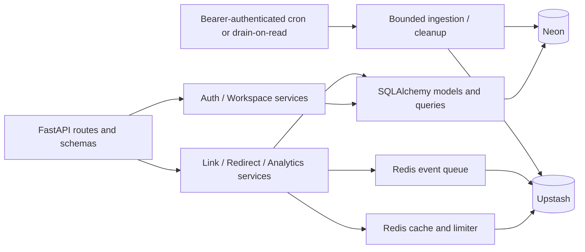
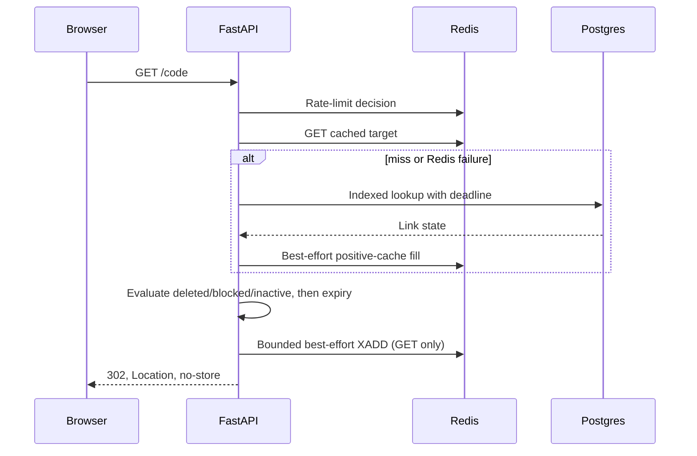

# Backend Architecture

Status: auth, sessions, workspace lifecycle, links, redirects and analytics reads implemented and deployed 2026-10-25; scheduled ingestion/retention operate on the free-plan daily schedule · [Plan](../README.md#implementation-plan) · [API](api.md) · [Data model](data-model.md)

## Shape and boundaries

Use a **modular monolith**, one FastAPI deployment and one Neon database, not microservices. Vercel handles instance scaling; durable state lives outside the process. Redirects, authentication and management share deployment resources in v1, so resource budgets and drain limits matter.



| Layer | Owns | Avoid |
| --- | --- | --- |
| Routes/schemas | HTTP validation, status mapping, session/workspace dependencies, request IDs | SQL or Redis commands |
| Services | Use cases, lifecycle rules, transaction intent, password hashing, role checks | FastAPI response objects |
| Models/queries | Parameterized SQL, locking, persistence | HTTP errors or cache policy |
| Adapters | Redis operations, client lifetime, timeouts | Product decisions |

Dependencies are explicit FastAPI dependencies (`api/deps.py`): one database session per request/worker transaction, no global session. The session cookie and `X-Workspace-Id` are resolved into a `WorkspaceContext` before route code runs. Keep that boundary; do not let routes parse cookies or membership rows themselves.

## Layout

```text
src/backend/
  main.py
  models.py
  core/{access_log,config,db,problems,redis,security}.py
  api/deps.py
  api/router.py
  api/routes/{auth,workspaces,links,redirect,internal,health}.py
  services/{auth,workspaces,links,analytics,ratelimit,validation}.py
```

All modules listed above exist. Alembic migrations live in `backend/alembic/`. The current suite has 71 backend tests covering security helpers, validation, analytics helpers, Redis fail-open boundaries and stream ingestion semantics (ACK ordering, reclaim, dead letters, legacy migration, status), account/workspace lifecycle, retention cleanup and access-log safety; 116 frontend tests cover API contracts and UI helpers. Real Postgres/Redis integration suites and automated browser tests remain release work. A 45-check production API smoke run covered signup, roles, invitations, ownership transfer, workspace deletion, CSRF, cross-tenant `404`s and session revocation on 2026-10-25; durable ingestion was smoke-tested locally against the live data services the same day.

## Accounts, sessions and tenancy

1. **Signup** normalizes the email, hashes the password with Argon2id, creates the user, a personal workspace and an `owner` membership in one transaction, then issues a session. Duplicate emails return `409 email_taken`. Email verification and password reset are intentionally out of scope for v1.
2. **Login** verifies against a dummy hash when the account is missing so timing does not reveal account existence, then creates a 30-day opaque session. Only a SHA-256 digest of the `shrs_` token is stored; raw tokens exist only in the cookie.
3. **Sessions** are sent as the `shortly_session` cookie: `HttpOnly`, `SameSite=Lax`, `Secure` outside local development, path `/`. Sign-out deletes the server row and clears the cookie. Sessions authenticate API calls; they are never placed in URLs or query keys. Each session has a public UUID for listing and targeted revocation; token digests are never returned.
4. **Password change** verifies the current password, rehashes with Argon2id, deletes every other session in the same commit and keeps the caller signed in. Session listing shows creation/expiry plus a `current` flag; revoke-others never deletes the current session.
5. **CSRF:** cookie-authenticated mutations must carry `Origin` (or a parseable `Referer`) listed in `CORS_ORIGINS`; otherwise `403 csrf_rejected`. Requests without either header are treated as non-browser clients. This pairs with `SameSite=Lax`; neither alone is the whole control.
6. **Workspace scope** comes from `X-Workspace-Id`; omitting it selects the caller's personal workspace. A workspace the caller does not belong to (or a missing personal workspace) returns `404 workspace_not_found`, not a leaky `403`.
7. **RBAC** is ordered `viewer < member < admin < owner`. Members create and manage links; admins additionally manage people, invitations and the workspace name; only owners change or remove admins and may delete or transfer a shared workspace. The owner row is immutable, self role changes are rejected, and an ownership transfer promotes the target while demoting the actor to `admin`.
8. **Workspace lifecycle** uses row locks on the acting and target memberships. Deletion requires an exact trimmed-name confirmation, refuses personal workspaces and hard-deletes links, clicks, invitations and memberships. Personal workspaces cannot be deleted or transferred.
9. **Invitations** return a one-time `shri_` token whose digest is stored. They expire after 7 days, may be bound to an email, and are accepted only by a signed-in user. Acceptance upserts membership; preview is available to the invited signed-in account.
10. **Legacy anonymous links** without `workspace_id` keep the ADR 0005 management-token path. New links always belong to a workspace and store no management token.

CORS uses exact origins with credentials enabled. The `*` wildcard is invalid with cookies and is never configured.

## Create path

1. Enforce body limit, origin check and fail-closed create limits; validate URL, alias and required UUID `Idempotency-Key`.
2. Authenticated creates require at least `member` in the active workspace. Unauthenticated creates are accepted only for the legacy token flow.
3. In **one Postgres transaction**, reserve the hashed key, generate a code and optional management token, insert the link, and store the AEAD-encrypted replay response.
4. A duplicate key waits within a bounded deadline: return the original response for identical input, `409` for a mismatch/in-progress transaction. Unique-code conflicts retry only generated codes.
5. Commit before returning `201`. Do not use Redis as a second authoritative replay store; a DB commit followed by a failed Redis write loses the original response and breaks retry safety.

Workspace-created responses contain no management token: authorization is membership, resolved on every later request. Replay therefore returns the same link, not an extra credential. [API](api.md#idempotent-creation) and [data model](data-model.md) define replay TTL, encryption and concurrency behavior.

## Redirect path



Redis caches only positive live targets, including absolute expiry; missing, deleted and blocked links are not negative-cached. Cache reads may reflect old state for up to the configured redirect TTL; post-commit invalidation improves freshness but is not a distributed transaction. The enqueue is awaited before the response and never converts a valid redirect into a failure; events may be lost if Redis is unavailable. `HEAD` resolves without recording.

Management mutations authenticate against the authoritative database row or membership, never a cached target. Urgent abuse revocation requires an edge deny rule across every backend hostname before the block is considered effective operationally; cached redirects are not strict revocation. See [caching](caching-and-scale.md).

## Management and analytics

- Authenticated management requires the session cookie plus workspace membership. Viewer requests are read-only. Legacy token management requires `X-Management-Token`.
- Supplying an invalid or stale session/credential returns `401`; never fall back to public metadata. Non-member workspaces and missing links return `404`.
- Authorized reads may inspect inactive or expired links. Soft-deleted links are `404`; a repeated DELETE with the same valid scope remains `204`.
- PATCH fields are absolute values; omitted and null expiry differ. `is_blocked` is operator-owned and never writable through public APIs.
- Workspace listing returns non-deleted links, including inactive and expired ones, with `clicks_30d` from daily rollups. Analytics requires the same scope and reads totals plus daily series from rollups and breakdowns from retained raw events.
- Query bounds use UTC dates and `[from, to)` semantics. The browser clears workspace-scoped caches when the session or active workspace changes.
- Analytics reads may drain up to 500 queued events first when `DRAIN_ON_READ=true`, providing eventual freshness between daily cron runs. Responses include a real queue snapshot (`freshness`), and `GET /internal/analytics/status` exposes backlog, pending age, lag and dead letters. Do not promise a one-minute guarantee on a free plan.

## Ingestion and consistency

The authenticated cron (or a drain-on-read) reads bounded batches from a Redis Stream consumer group. A batch is acknowledged and deleted only after its database transaction commits; a crash or failed commit leaves it pending, where `XAUTOCLAIM` recovers it after an idle threshold. Malformed payloads and messages that exhaust the delivery budget move to a bounded dead-letter stream. Raw rows insert with `ON CONFLICT (event_id) DO NOTHING RETURNING`, and rollups increment from **only the returned rows** in the same transaction. Legacy list entries are migrated through a processing list so a crash mid-move cannot lose them.

Capture is best-effort: Redis failure at enqueue or provider data loss may lose events. Accepted events are processed at-least-once and the database makes repeats idempotent. Do not describe this as end-to-end exactly-once or lossless analytics. Retention cleanup is bounded: expired replay rows, raw clicks older than the 90-day window, and daily totals older than two years.

## Failure policies

| Failure | Redirect | Auth / workspace / links |
| --- | --- | --- |
| Redis timeout | Redirect still resolves; limiter fails open with bounded DB fallback; event may be lost | Rate-limited endpoints fail closed with `503` |
| Postgres unavailable | Valid unexpired cache hit only; otherwise `503` | `503`; never bypass session or role verification |
| Invalid cookie/session | Not applicable | `401`; private frontend state is cleared |
| Workspace mismatch | Not applicable | `404`, with no metadata leak |
| Missed cron | Redirects and reads continue | Analytics freshness is reported as stale |

DB fallback uses short pool waits; saturation returns a controlled `503` instead of exhausting connections. Shared security decisions must not depend on per-instance circuit state.

## Configuration and deployment boundary

Application settings are unprefixed (`ENVIRONMENT`, `DATABASE_URL`, `SECRET_KEY`, `CRON_SECRET`, `CORS_ORIGINS`, and so on), loaded from the environment or gitignored `backend/.env`.

- `SECRET_KEY` is expanded with HKDF into the token pepper and replay-encryption key. Rotating it invalidates existing management tokens and replay ciphertexts; versioned keys are required before in-place rotation.
- Session tokens are not derived from `SECRET_KEY`; they are random and stored hashed, so they survive an application key rotation unlike legacy management tokens.
- `ENVIRONMENT=production` sets the `Secure` cookie flag and disables debug/docs. Production CORS must list the exact frontend origin, including scheme, and never `*`.
- OpenAPI builds offline without database or Redis credentials.
- The entrypoint is the root `main:app` shim in `backend/main.py`; Vercel resolves it with `"framework": "fastapi"`. Migrations run in a controlled job, never during import, request handling or cold start.

The short-link origin comes from `SHORT_BASE_URL`; it is unrelated to the frontend origin. One chosen function region must match Neon and Upstash locations.

## Production acceptance

- Unit tests: URL/alias boundaries, password and session helpers, role rules, time, token versions, error mapping.
- Real Postgres/Redis integration tests: uniqueness, concurrent replay, cache refill/mutation races, duplicate drains, auth/session expiry and bounded resource failures.
- Contract tests: OpenAPI generated types and documented errors/headers.
- Browser tests: signup/login/logout, CSRF rejection, invitation acceptance, all four roles, workspace switching, settings (password change, session revoke, rename, transfer, delete with fallback), legacy token entry, authorization cache clearing, rich analytics and UTC dates.
- Authorized isolated load tests: measured RPS/cold-start/command costs, drain throughput and connection headroom. Never load-test third-party destinations or unapproved production environments.
- Release gates: dependency audits, privacy-safe logs, erasure/takedown and account-deletion procedures, backup restore and rollback drill. See the [implementation plan](../README.md#implementation-plan).
