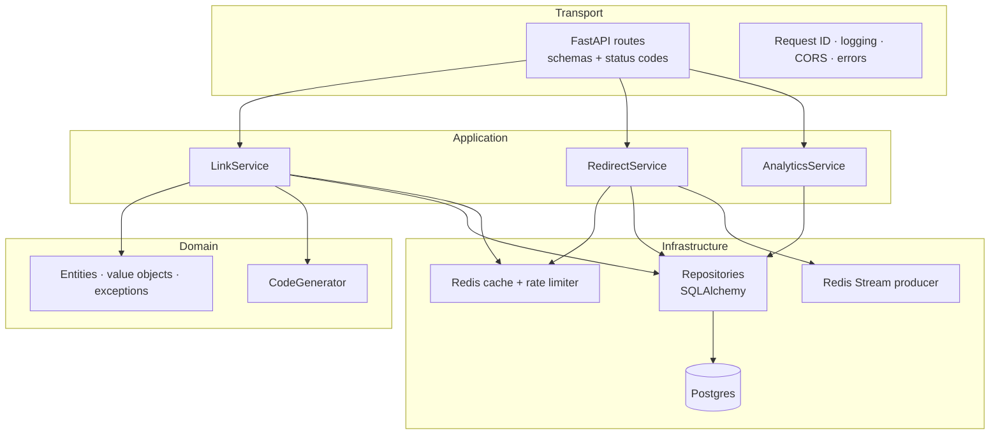
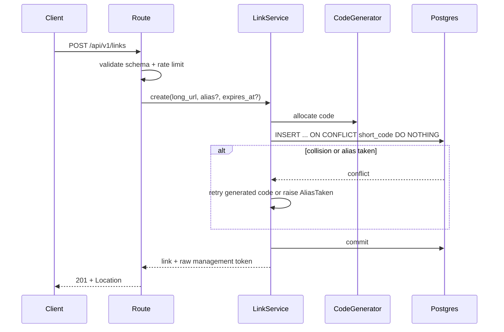
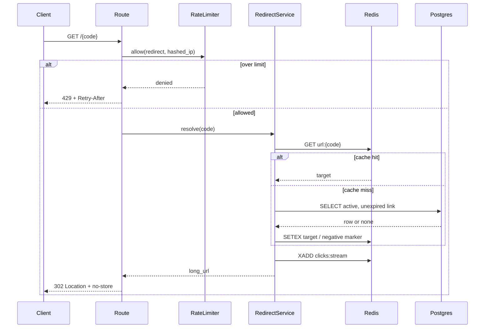

# Backend Architecture

Status: target design · Related: [API](api.md) · [Data model](data-model.md) · [Deployment](deployment.md)

## Responsibilities

The backend owns:

- Validating and normalizing destination URLs.
- Allocating short codes and custom aliases.
- Persisting links and their lifecycle state.
- Serving fast redirects.
- Authenticating anonymous management tokens.
- Capturing click events and producing analytics.
- Enforcing rate limits and abuse controls.
- Exposing the versioned REST API consumed by the web app.

It does not render the web app, store files, or fetch destination URLs in v1.

## Architectural style

A modular monolith deployed as one Vercel Function. The layers are separated by dependency direction, not by network boundaries.



### Layer rules

| Layer | May depend on | Must not contain |
| --- | --- | --- |
| `api/` | schemas, services, FastAPI | SQL, Redis commands, business rules |
| `services/` | domain, repository protocols, cache/stream interfaces | FastAPI imports, ORM query details |
| `domain/` | standard library only | I/O, frameworks, database models |
| `repositories/` | SQLAlchemy, domain entities | HTTP status codes, cache policy |
| `cache/`, `db/` | clients and config | Business decisions |

Dependencies point inward. Services depend on protocols; concrete adapters are injected by FastAPI dependencies. This keeps the hot redirect logic testable without a running Postgres or Redis.

## Target package layout

```text
backend/
├── pyproject.toml
├── uv.lock
├── .env.example
├── alembic.ini
├── src/backend/
│   ├── main.py                  # create_app, lifespan, middleware
│   ├── api/
│   │   ├── dependencies.py      # session, clients, service wiring
│   │   ├── errors.py            # Problem Details handlers
│   │   ├── middleware.py        # request ID, access logs
│   │   ├── router.py            # /api/v1 composition
│   │   └── routes/
│   │       ├── health.py        # /health, /ready
│   │       ├── links.py         # create, read, update, delete
│   │       ├── redirects.py     # GET /{code}
│   │       ├── analytics.py     # per-link analytics
│   │       └── internal.py      # cron-authenticated drain
│   ├── core/
│   │   ├── config.py            # typed settings
│   │   ├── logging.py           # JSON formatter
│   │   ├── security.py          # token generation + hashing
│   │   └── time.py              # clock abstraction
│   ├── domain/
│   │   ├── entities.py
│   │   ├── exceptions.py
│   │   └── value_objects.py     # ShortCode, LongUrl, Alias
│   ├── services/
│   │   ├── link_service.py
│   │   ├── redirect_service.py
│   │   └── analytics_service.py
│   ├── repositories/
│   │   ├── protocols.py
│   │   ├── link_repository.py
│   │   └── click_repository.py
│   ├── db/
│   │   ├── session.py
│   │   ├── models.py
│   │   └── migrations/
│   ├── cache/
│   │   ├── redis.py
│   │   └── keys.py
│   └── workers/
│       └── analytics_drain.py
└── tests/
    ├── unit/
    ├── integration/
    └── conftest.py
```

The current scaffold has `main.py`, `api/routes/health.py`, and `core/config.py`. The remaining modules are added as each milestone lands.

## Core components

### `LinkService`

Use cases: create, get, update, soft-delete, verify management token.

- Validates and normalizes input.
- Allocates a generated or custom code.
- Hashes the management token before persistence.
- Retries generated-code collisions.
- Invalidates the redirect cache after commits.
- Never returns the raw token after creation.

### `RedirectService`

The hot path. Its contract is: return a destination or raise a domain error, without doing analytics work synchronously.

- Checks the rate limiter.
- Reads `url:{code}` from Redis.
- Falls back to Postgres on a miss and repopulates the cache.
- Rejects inactive, deleted, or expired links.
- Appends a click event to a Redis Stream as a best-effort side effect.
- Returns the target so the route can emit `302`.

### `AnalyticsService`

- Verifies the management token.
- Reads daily rollups for historical ranges.
- Reads raw events for the current day and optional breakdowns.
- Applies retention and date-range limits.

### `CodeGenerator`

Pure component with injected randomness. Generates 7-character Base62 codes and validates custom aliases. See [short-links.md](short-links.md).

### `RateLimiter`

Redis-backed counter keyed by scope, hashed client identifier, and time window. It returns a decision plus reset metadata; the route maps that to headers and `429`.

### `Clock`

Injected UTC clock. Expiry and analytics code use it instead of calling `datetime.now()` directly, which makes time-dependent tests deterministic.

## Request lifecycle

### Create a link



The link row and its token hash are written in one transaction. Cache does not need warming on create; the first redirect is a cache miss.

### Follow a link



Steps are ordered so that neither analytics nor cache writes can turn a valid redirect into an error.

### Drain analytics

The internal route is called by a scheduler, authenticated with `CRON_SECRET`, and is idempotent. It reads a bounded batch from the stream, inserts events with `ON CONFLICT (event_id) DO NOTHING`, recomputes affected daily rollups, and acknowledges the stream entries. Details in [analytics.md](analytics.md).

## Transactions and consistency

- **Create**: single transaction; unique index is the source of truth for code ownership.
- **Update/delete**: transaction first, then best-effort cache invalidation. If invalidation fails, the cached entry expires by TTL; mutations also bump `updated_at` for auditing.
- **Redirect read**: no transaction spans the cache and database. The database row is authoritative; cached entries carry `is_active` and `expires_at` and are re-checked on read.
- **Analytics ingestion**: at-least-once delivery from the stream; `event_id` uniqueness plus idempotent rollup recomputation prevents double counting.
- **Idempotent create**: an optional `Idempotency-Key` stores the request fingerprint and response in Redis for 24 hours.

## Failure policy

| Dependency failure | Redirect | Create / manage | Analytics |
| --- | --- | --- | --- |
| Redis unavailable | Fall back to Postgres; log and alert | Allow if rate limiter fails open; log and alert | Drop event, log metric |
| Postgres unavailable | Serve cache hit if possible; otherwise `503` | `503` | Pause drain; retry next run |
| Stream append fails | Redirect still succeeds | n/a | Event lost; alert on rate |
| Cron missed | No user impact | No user impact | Backlog; drain catches up |

Fail-open behavior applies only to rate limiting and click capture. Authorization and persistence always fail closed.

## Configuration

All settings are environment variables with the `URLSHORTNER_` prefix, parsed by `pydantic-settings`. Required in production:

- `DATABASE_URL` — Neon pooled async URL.
- `REDIS_URL` — Upstash TLS URL.
- `PUBLIC_BASE_URL` — public short-link origin.
- `CORS_ORIGINS` — JSON array of allowed web origins.
- `MANAGEMENT_TOKEN_PEPPER` — server-side HMAC pepper for token hashes.
- `ANALYTICS_IP_SALT` — salt used for hashed visitor identifiers.
- `CRON_SECRET` — bearer token for internal scheduled routes.

Debug mode and interactive API docs are disabled when `ENVIRONMENT=production`.

## Testing strategy

| Level | Scope | Tools |
| --- | --- | --- |
| Unit | Code generation, validation, token hashing, cache-key logic, rate-limit decisions | pytest, fakes |
| Integration | Repositories, migrations, Redis cache, stream drain, API routes | pytest, httpx ASGITransport, Testcontainers or Docker Compose |
| Contract | OpenAPI schema snapshot; generated frontend types | FastAPI schema dump, CI diff |
| Load | Redirect p95, cache hit ratio, error rate under sustained load | k6 |

CI must run `ruff check`, `ruff format --check`, and `pytest`. Integration tests use a disposable Postgres and Redis; they do not touch preview or production data.

## Design constraints from Vercel

- Instances are ephemeral: no in-process caches that are required for correctness.
- Connections must be pooled conservatively; Neon's pooler absorbs function concurrency.
- Long work belongs in the scheduled drain, not in the request path (cleanup is capped at 500 ms on shutdown).
- The whole app is one function bundle, so keep runtime dependencies small.
- `tool.vercel.entrypoint` points at `backend.main:app`; see [deployment.md](deployment.md).
