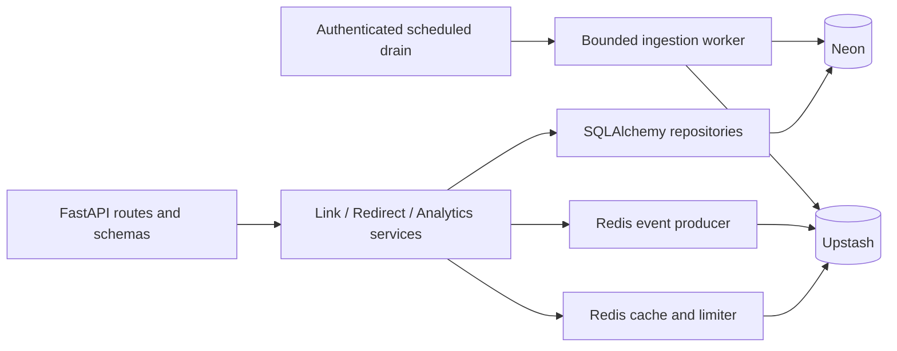
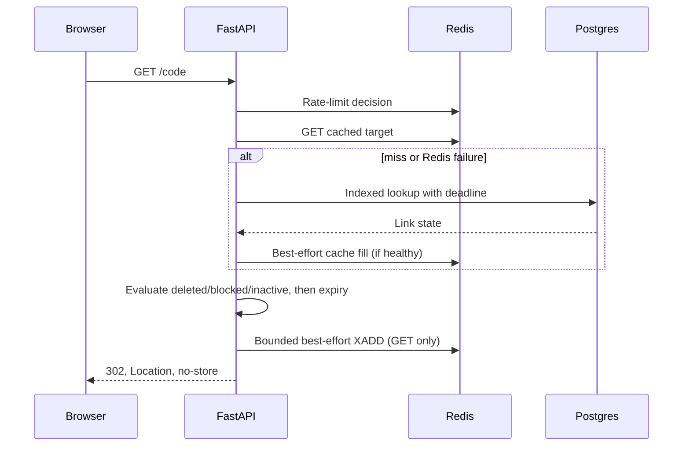

# Backend Architecture

Status: target design, not implemented · [Plan](../README.md#implementation-plan) · [API](api.md) · [Data model](data-model.md)

## Shape and boundaries

Use a **modular monolith**, one FastAPI deployment and one Neon database, not microservices. Vercel handles instance scaling; durable state lives outside the process. Redirects and management share deployment resources in v1, so resource budgets and internal-worker timeouts matter.



| Layer | Owns | Avoid |
| --- | --- | --- |
| Routes/schemas | HTTP validation, status mapping, auth headers, request IDs | SQL or Redis commands |
| Services | Use cases, lifecycle rules, transaction intent | FastAPI response objects |
| Repositories | Parameterized queries, locking, persistence | HTTP errors or cache policy |
| Adapters | Redis operations, client lifetime, timeouts | Product decisions |

Keep dependencies explicit with FastAPI dependencies; one database session per request/worker transaction, not a global session. Engines and Redis clients may be reused within an instance/event loop. A small injectable clock and code generator enable deterministic tests. Add protocols only at actual I/O seams; do not pre-create empty domain layers, generic repository frameworks, or future account modules.

## Incremental layout

```text
src/backend/
  main.py
  core/config.py
  core/security.py
  api/dependencies.py
  api/errors.py
  api/router.py
  api/routes/{health,links,redirects,analytics,internal}.py
  services/{links,redirects,analytics}.py
  repositories/{links,analytics}.py
  db/{session,models}.py
  cache/{redis,keys}.py
  workers/analytics_drain.py
```

Only `main.py`, configuration, router and health route exist today. Add modules with their feature, not in advance. Alembic migrations and integration tests accompany the first persistence milestone.

## Create path

1. Enforce body limit and fail-closed create limits; validate URL, alias and required random idempotency key.
2. In **one Postgres transaction**, reserve the hashed key, generate a code/token, insert the link, and store the AEAD-encrypted replay response.
3. A duplicate key waits within a bounded deadline: return the original response for identical input, `409` for a mismatch/in-progress transaction. Unique-code conflicts retry only generated codes.
4. Commit before returning `201`. Do not use Redis as a second authoritative replay store; a DB commit followed by a failed Redis write loses the original token and breaks retry safety.

[API](api.md#idempotent-creation) and [data model](data-model.md) define replay TTL, encryption, concurrency and crash behavior.

## Redirect path



The enqueue is **awaited before the response**; it consumes latency even though database ingestion is asynchronous. It gets a 50 ms deadline initially, no hot-path retry, and never converts a valid redirect to failure. Do not schedule untracked background tasks and assume a serverless process survives the response.

HEAD follows the same resolution without capture. Cache hits carry their own expiry and absolute cache deadline. No negative cache in v1. Positive-cache reads may reflect old state for at most the documented 60-second cache-age window; post-commit invalidation improves freshness but is not a distributed transaction.

Urgent abuse revocation requires an edge deny rule across both backend hosts before the database block is acknowledged operationally. Cached redirects are not a strict revocation mechanism. See [caching](caching-and-scale.md).

## Management and analytics

- Authenticate on the authoritative DB row, never a cached target. A supplied invalid token returns `401`; never silently fall back to public metadata.
- Authorized GET may inspect inactive/expired links. Deleted/blocked links are `404`; repeat DELETE with a valid token is the sole deleted-row exception.
- PATCH fields are absolute values; omitted and null expiry differ. Operator `is_blocked` is never writable by public API clients.
- Analytics reads totals and daily series from rollups and rich dimensions from retained raw events. V1 includes country/device/referrer-origin breakdowns, not unique visitors.
- Query bounds use UTC dates and `[from, to)` semantics. Auth-scoped browser caches must be cleared when a token changes or is forgotten.

## Ingestion and consistency

The scheduler invokes a bounded drain. Consumer-group delivery may duplicate or overlap. Insert raw events with a unique `event_id`, obtain newly inserted rows with `RETURNING`, and atomically increment rollups from **those rows only**, in the same database transaction. ACK and delete stream entries only after commit. Locks may reduce redundant workers but cannot be the correctness boundary.

Capture is best-effort: Redis failure/overflow may lose events. Accepted, retained events receive retryable at-least-once processing; the database makes repeats idempotent. Do not describe this as end-to-end exactly-once or lossless analytics.

## Failure policies

| Failure | Redirect | Create / management / analytics |
| --- | --- | --- |
| Redis timeout | Fail-open limiter; bounded DB fallback | Fail-closed limiter, `503` |
| Postgres unavailable | Valid unexpired cache hit only; otherwise `503` | `503`, never bypass token verification |
| Event enqueue timeout | Redirect succeeds; record potential loss | No synchronous analytics fallback |
| Worker DB failure | No immediate redirect impact | Leave events pending for retry |
| Missed schedule | Redirect remains available | Expose stale analytics; alert on oldest unprocessed event |

DB fallback has a short pool wait and query deadline; saturation returns controlled `503` instead of exhausting connections. Small per-instance backoff/circuit state may suppress repeated failed Redis calls, but shared security decisions must not depend on it.

## Configuration and deployment boundary

Application settings use `URLSHORTNER_`; platform **`CRON_SECRET` is the exception** and must be explicitly mapped in settings. Use distinct token-pepper, replay-encryption, and rate-limit HMAC keys; no permanent IP hash is required for analytics.

Build OpenAPI offline without requiring database credentials or connecting to dependencies. Validate required production secrets at runtime startup. Production must reject debug mode, disable interactive docs, and use exact noncredentialed CORS; these are targets, not current scaffold behavior.

One chosen function region must match Neon/Upstash locations. Current package entrypoint is `backend.main:app`; verify Vercel's resolved source file in a preview before treating deployment as supported. Do not run migrations during import, request handling or cold start.

## Production acceptance

- Unit tests: URL/alias boundaries, time, token versions, error mapping.
- Real Postgres/Redis integration tests: uniqueness, concurrent replay, cache refill/mutation races, duplicate and overlapping drains, bounded resource failures.
- Contract tests: OpenAPI generated types and documented errors/headers.
- Browser tests: create/retry, manual token recovery, opt-in storage, auth cache clearing, rich analytics and UTC dates.
- Authorized isolated load tests: measured RPS/cold-start/command costs, queue drain throughput, connection headroom. Never load-test third-party destinations or unapproved production environments.
- Release gates: dependency audits, privacy-safe logs, erasure/takedown procedure, backup restore and rollback drill. See the [implementation plan](../README.md#implementation-plan).
