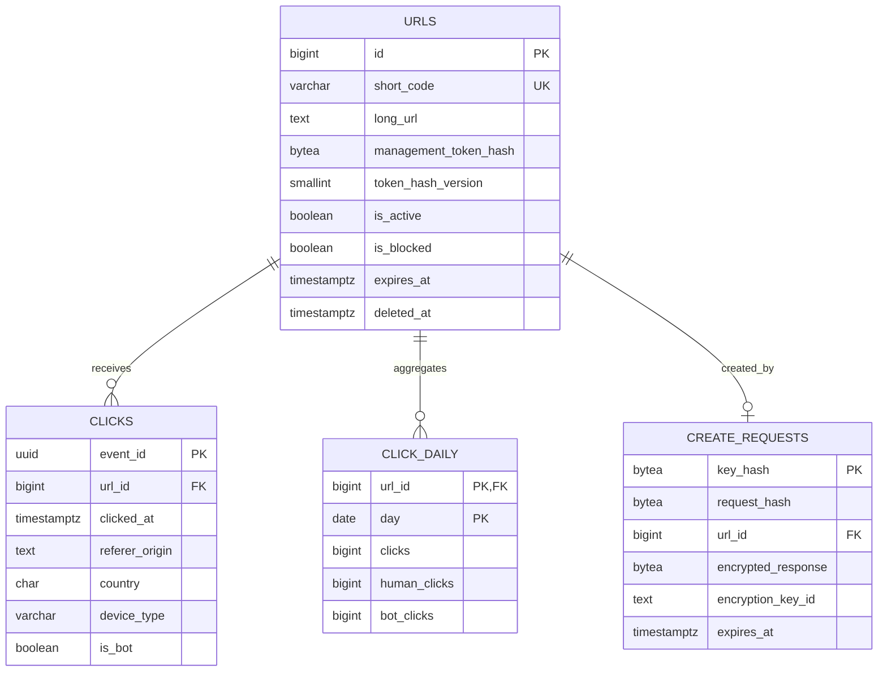

# Data Model

Status: target design · Neon Postgres · SQLAlchemy 2.x async · Alembic

## V1 entities



Accounts-ready means additive evolution, not an unused identity system. Do not create `users`, `citext`, or an unenforced `owner_id` in v1. When accounts arrive, add the identity table, nullable foreign key and listing index in an expand migration; anonymous rows naturally remain unowned.

## Link schema

Illustrative migration SQL; Alembic migrations and integration tests become authoritative when implemented.

```sql
CREATE TABLE urls (
    id BIGINT GENERATED ALWAYS AS IDENTITY PRIMARY KEY,
    short_code VARCHAR(32) COLLATE "C" NOT NULL UNIQUE,
    long_url TEXT NOT NULL CHECK (char_length(long_url) BETWEEN 1 AND 8192),
    management_token_hash BYTEA NOT NULL CHECK (octet_length(management_token_hash) = 32),
    token_hash_version SMALLINT NOT NULL CHECK (token_hash_version > 0),
    is_custom_alias BOOLEAN NOT NULL DEFAULT FALSE,
    is_active BOOLEAN NOT NULL DEFAULT TRUE,
    is_blocked BOOLEAN NOT NULL DEFAULT FALSE,
    expires_at TIMESTAMPTZ,
    created_at TIMESTAMPTZ NOT NULL DEFAULT now(),
    updated_at TIMESTAMPTZ NOT NULL DEFAULT now(),
    deleted_at TIMESTAMPTZ,
    CHECK (
        (is_custom_alias AND short_code ~ '^[a-z0-9][a-z0-9_-]{1,30}[a-z0-9]$')
        OR (NOT is_custom_alias AND short_code ~ '^[A-Za-z0-9]{7}$')
    ),
    CHECK (expires_at IS NULL OR expires_at > created_at)
);
```

- IDs are internal, never required in browser JSON (avoids JavaScript bigint precision problems).
- The case-sensitive unique constraint includes deleted rows; codes never change or get reused.
- Service validation enforces reserved codes, safe URL schemes and expiry relative to request time; database checks are the final integrity boundary.
- `is_blocked` is operator-owned and cannot be changed by a management token. Operators must audit block actions without logging targets or tokens.
- State order: missing/deleted/blocked/inactive → `404`, then expired → `410`, otherwise redirect. Do not mutate active state during expiry cleanup.

## Atomic create replay

```sql
CREATE TABLE create_requests (
    key_hash BYTEA PRIMARY KEY CHECK (octet_length(key_hash) = 32),
    request_hash BYTEA NOT NULL CHECK (octet_length(request_hash) = 32),
    url_id BIGINT UNIQUE REFERENCES urls(id),
    encrypted_response BYTEA,
    encryption_key_id TEXT,
    created_at TIMESTAMPTZ NOT NULL DEFAULT now(),
    expires_at TIMESTAMPTZ NOT NULL,
    CHECK (expires_at > created_at),
    CHECK (
        (url_id IS NULL AND encrypted_response IS NULL AND encryption_key_id IS NULL)
        OR (url_id IS NOT NULL AND encrypted_response IS NOT NULL AND encryption_key_id IS NOT NULL)
    )
);
CREATE INDEX create_requests_expiry_idx ON create_requests(expires_at);
```

The API requires a random UUIDv4 `Idempotency-Key`. Store its SHA-256 digest, a hash of canonical validated input, and the completed response encrypted with authenticated encryption (AEAD, unique nonce, key ID). Bind ciphertext to the key/request digests as associated data. The separate encryption key is not the token pepper.

Reserve the key, allocate the link, fill the encrypted response, and commit **one Postgres transaction**. A reservation must never commit incomplete; test this application invariant with crash injection. Concurrent inserts on the same primary key serialize. On bounded lock-wait timeout return `409 request_in_progress`; the client retains the same key. A crash before commit rolls everything back; after commit, replay decrypts the original response, including its management token.

The server enforces expiry on every replay (24 hours), regardless of cleanup timing. Delete expired replay rows in bounded batches. They are capabilities: never put plaintext keys or responses in logs. Backup retention may outlive the live 24-hour record; protect backups and retire old replay encryption keys after their live replay windows end. After expiry the same key may create a new link; clients must not automatically retry indefinitely.

## Raw clicks

```sql
CREATE TABLE clicks (
    event_id UUID PRIMARY KEY,
    url_id BIGINT NOT NULL REFERENCES urls(id) ON DELETE CASCADE,
    clicked_at TIMESTAMPTZ NOT NULL,
    ingested_at TIMESTAMPTZ NOT NULL DEFAULT now(),
    referer_origin TEXT CHECK (referer_origin IS NULL OR char_length(referer_origin) <= 2048),
    country CHAR(2) CHECK (country IS NULL OR country ~ '^[A-Z]{2}$'),
    device_type VARCHAR(16) NOT NULL CHECK (device_type IN ('desktop','mobile','tablet','bot','unknown')),
    is_bot BOOLEAN NOT NULL
);
CREATE INDEX clicks_url_clicked_idx ON clicks(url_id, clicked_at);
CREATE INDEX clicks_clicked_idx ON clicks(clicked_at);
```

No raw IP, persistent IP hash, raw user agent, referrer path, query, or fragment is persisted. V1 reports event counts and dimensions, not unique visitors. The stream briefly carries a bounded UA for worker classification; Postgres stores only the classification. Country is coarse platform metadata, not verified identity.

`event_id` is generated once per successful GET before enqueue; duplicate delivery must reuse it. Distinct real requests are distinct events even if they come from the same browser.

## Daily totals

```sql
CREATE TABLE click_daily (
    url_id BIGINT NOT NULL REFERENCES urls(id) ON DELETE CASCADE,
    day DATE NOT NULL,
    clicks BIGINT NOT NULL CHECK (clicks >= 0),
    human_clicks BIGINT NOT NULL CHECK (human_clicks >= 0),
    bot_clicks BIGINT NOT NULL CHECK (bot_clicks >= 0),
    PRIMARY KEY (url_id, day),
    CHECK (clicks = human_clicks + bot_clicks)
);
```

In one transaction, insert raw events with `ON CONFLICT (event_id) DO NOTHING RETURNING ...`, aggregate **only newly inserted rows**, then atomically add those deltas to `click_daily`. Replays insert no rows and add no counts. Concurrent drains safely increment the same daily row; do not recompute-and-overwrite totals from concurrent snapshots. Upsert pairs in `(url_id, day)` order to reduce deadlocks, and retry rolled-back worker transactions within the job deadline.

See [analytics.md](analytics.md) for the transaction and acknowledgment protocol. Reads sum rollups for all days (including today); do not also add today's raw events and double-count them. Raw rows supply breakdowns for up to 90 days.

## Retention and access patterns

| Data | Retention | Query/index or cleanup |
| --- | --- | --- |
| Links and reserved codes | Indefinite until an explicit policy changes | Unique `short_code` lookup |
| Soft-deleted links | No public or analytics access; code retained | Token-valid repeat DELETE may return 204 |
| Replay responses | 24 hours of API replay | `key_hash`; bounded expiry cleanup |
| Accepted event age | At most 24 hours old; no more than 5 minutes ahead | Checked before raw insert |
| Raw clicks | Last 90 UTC calendar days, including today | `(url_id, clicked_at)` queries; batched retention delete |
| Daily totals | 2 years | `(url_id, day)`; batched retention delete |
| Stream/dead letters | Bounded by age, bytes, and count | See analytics pipeline |

The raw-event cutoff is 00:00 UTC on `today_utc - 89 days`, not a rolling 90 × 24-hour boundary. Reads enforce it even if cleanup is delayed; maintenance deletes older rows using the same cutoff. Monitor cleanup lag separately from the API's visible window.

The 24-hour event acceptance horizon is well inside the 90-day deduplication retention. An old stream replay cannot reintroduce a deleted raw event and double-count a preserved rollup. Never extend replay age past deduplication retention without redesigning the ledger.

Operators need an authorized erasure procedure before launch: purge target/event data while retaining a minimal non-reusable code tombstone; document backup expiry and privacy-request handling. A normal DELETE disables a link, not a promise of immediate erasure from backups.

## Growth assumptions

Start with one region, a small runtime connection pool and indexed tables. Measure rather than claim supported RPS.

- At 10 redirects/s, raw events reach 864,000/day and 77.76 million over 90 days. Rich-event retention can dominate cost even for a small link catalogue.
- Estimate storage from measured row/index sizes and actual active link-days, not links × every calendar day. Query `pg_total_relation_size` and sample payload sizes.
- Revisit retention and analytics storage before the database/queue budget is exhausted. Partitioning is not a free switch: Postgres partitioned uniqueness must include partition keys. Keeping global `event_id` deduplication requires a separate ledger or an explicitly redesigned composite key.
- Use `EXPLAIN (ANALYZE, BUFFERS)` on representative analytics ranges. Do not add owner/expiry indexes before a corresponding workload exists.

## Migration and recovery gates

- Alembic only; no schema creation on cold start. Run migrations once in a controlled job using a separate DDL role and direct database connection.
- Expand/contract changes; keep old deployments compatible through rollback. Failed migrations require a tested forward fix or safe rollback, never blind downgrade.
- Disposable Postgres/Redis integration tests cover collisions, concurrent idempotency, duplicate/concurrent ingestion, retention boundaries, and link state.
- Reconcile recent rollups against raw counts as a diagnostic. Repairs require serialized maintenance; no concurrent full-table recompute that overwrites live deltas.
- Verify backups and a restore into an isolated database before launch; provisional RPO ≤24 hours and RTO ≤4 hours must match the purchased plan and a measured restore drill. Analytics loss limits are separate.
