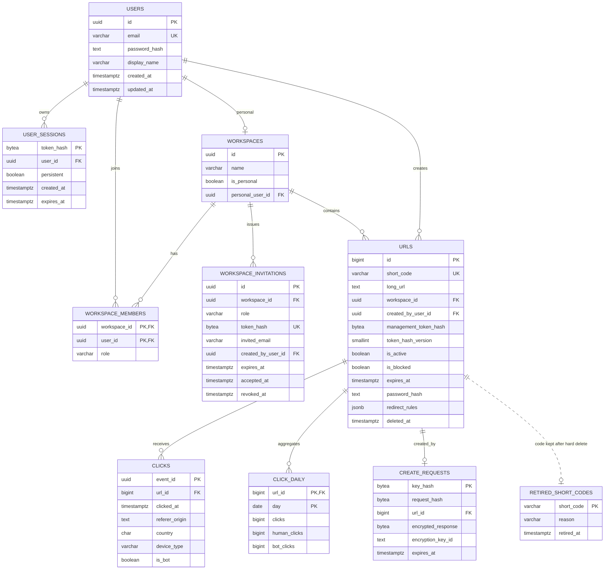

# Data Model

Status: implemented through auth, workspace lifecycle, links, analytics and bounded credential/replay/event cleanup · Neon Postgres · SQLAlchemy 2.x async · Alembic

## V1 entities



Accounts and workspaces are implemented. New links belong to a workspace; the legacy token model remains only for rows with `workspace_id IS NULL`. A database check enforces exactly one scope per link: workspace links have no token hash, legacy links always have one. Do not add a second ownership model for new links.

```sql
CREATE TABLE users (
    id UUID PRIMARY KEY,
    email VARCHAR(320) NOT NULL UNIQUE CHECK (email = lower(email)),
    password_hash TEXT NOT NULL,
    display_name VARCHAR(80) NOT NULL CHECK (char_length(display_name) BETWEEN 1 AND 80),
    created_at TIMESTAMPTZ NOT NULL DEFAULT now(),
    updated_at TIMESTAMPTZ NOT NULL DEFAULT now()
);

CREATE TABLE user_sessions (
    token_hash BYTEA PRIMARY KEY CHECK (octet_length(token_hash) = 32),
    id UUID NOT NULL UNIQUE,
    user_id UUID NOT NULL REFERENCES users(id) ON DELETE CASCADE,
    persistent BOOLEAN NOT NULL DEFAULT TRUE,
    created_at TIMESTAMPTZ NOT NULL DEFAULT now(),
    expires_at TIMESTAMPTZ NOT NULL,
    CHECK (expires_at > created_at)
);

CREATE TABLE workspaces (
    id UUID PRIMARY KEY,
    name VARCHAR(80) NOT NULL CHECK (char_length(name) BETWEEN 1 AND 80),
    is_personal BOOLEAN NOT NULL,
    personal_user_id UUID UNIQUE REFERENCES users(id) ON DELETE CASCADE,
    created_at TIMESTAMPTZ NOT NULL DEFAULT now(),
    updated_at TIMESTAMPTZ NOT NULL DEFAULT now(),
    CHECK (
        (is_personal AND personal_user_id IS NOT NULL)
        OR (NOT is_personal AND personal_user_id IS NULL)
    )
);

CREATE TABLE workspace_members (
    workspace_id UUID NOT NULL REFERENCES workspaces(id) ON DELETE CASCADE,
    user_id UUID NOT NULL REFERENCES users(id) ON DELETE CASCADE,
    role VARCHAR(16) NOT NULL CHECK (role IN ('owner','admin','member','viewer')),
    created_at TIMESTAMPTZ NOT NULL DEFAULT now(),
    PRIMARY KEY (workspace_id, user_id)
);

CREATE TABLE workspace_invitations (
    id UUID PRIMARY KEY,
    workspace_id UUID NOT NULL REFERENCES workspaces(id) ON DELETE CASCADE,
    role VARCHAR(16) NOT NULL CHECK (role IN ('admin','member','viewer')),
    token_hash BYTEA NOT NULL UNIQUE CHECK (octet_length(token_hash) = 32),
    invited_email VARCHAR(320),
    created_by_user_id UUID REFERENCES users(id) ON DELETE SET NULL,
    created_at TIMESTAMPTZ NOT NULL DEFAULT now(),
    expires_at TIMESTAMPTZ NOT NULL,
    accepted_at TIMESTAMPTZ,
    accepted_by_user_id UUID REFERENCES users(id) ON DELETE SET NULL,
    revoked_at TIMESTAMPTZ,
    CHECK (expires_at > created_at)
);
```

Personal workspaces cascade with their user. Non-personal workspaces have no `owner_id`; the owner is a membership row, so a raw user delete would leave a shared workspace without an owner. Account deletion (`DELETE /auth/account`, `services/accounts.py`) therefore plans first: it refuses while the user owns a shared workspace with other members, and otherwise deletes the personal workspace and sole-member shared workspaces explicitly before the user row. Sessions and memberships cascade; links the user created in other workspaces keep their row with `created_by_user_id` set to null.

`user_sessions.id` is a non-secret UUID used only to list and revoke a session; `token_hash` remains the primary key and is never returned by the API. Migration `e7b3a9c14d52` added and backfilled it. `user_sessions.persistent` records "Stay signed in": persistent rows last 30 days and are extended to a fresh 30 days once past half their life; non-persistent rows last 24 hours and are never extended. Migration `c8e2f5a93b17` added it with a `true` server default, matching the 30-day sessions issued before it. Every authenticated request loads the session, user and (when needed) the selected workspace membership in one joined query. Deleting a non-personal workspace hard-deletes its membership, invitation and link rows; sessions and users are unaffected.

## Link schema

Schema is authoritative in `backend/src/backend/models.py` and the Alembic chain. The SQL below documents the intended shape.

```sql
CREATE TABLE urls (
    id BIGINT GENERATED ALWAYS AS IDENTITY PRIMARY KEY,
    short_code VARCHAR(32) COLLATE "C" NOT NULL UNIQUE,
    long_url TEXT NOT NULL CHECK (char_length(long_url) BETWEEN 1 AND 8192),
    workspace_id UUID REFERENCES workspaces(id) ON DELETE CASCADE,
    created_by_user_id UUID REFERENCES users(id) ON DELETE SET NULL,
    management_token_hash BYTEA CHECK (octet_length(management_token_hash) = 32),
    token_hash_version SMALLINT CHECK (token_hash_version > 0),
    is_custom_alias BOOLEAN NOT NULL DEFAULT FALSE,
    is_active BOOLEAN NOT NULL DEFAULT TRUE,
    is_blocked BOOLEAN NOT NULL DEFAULT FALSE,
    expires_at TIMESTAMPTZ,
    fallback_url TEXT CHECK (fallback_url IS NULL OR char_length(fallback_url) BETWEEN 1 AND 8192),
    max_clicks INTEGER CHECK (max_clicks IS NULL OR max_clicks BETWEEN 1 AND 1000000),
    clicks_used INTEGER NOT NULL DEFAULT 0 CHECK (clicks_used >= 0),
    password_hash TEXT,
    redirect_rules JSONB CONSTRAINT urls_redirect_rules_array
        CHECK (redirect_rules IS NULL OR jsonb_typeof(redirect_rules) = 'array'),
    created_at TIMESTAMPTZ NOT NULL DEFAULT now(),
    updated_at TIMESTAMPTZ NOT NULL DEFAULT now(),
    deleted_at TIMESTAMPTZ,
    CHECK (
        (is_custom_alias AND short_code ~ '^[a-z0-9][a-z0-9_-]{1,30}[a-z0-9]$')
        OR (NOT is_custom_alias AND short_code ~ '^[A-Za-z0-9]{5,7}$')
    ),
    CHECK (
        (workspace_id IS NULL AND management_token_hash IS NOT NULL AND token_hash_version IS NOT NULL)
        OR (workspace_id IS NOT NULL AND management_token_hash IS NULL AND token_hash_version IS NULL)
    ),
    CHECK (expires_at IS NULL OR expires_at > created_at)
);
CREATE INDEX urls_workspace_created_idx ON urls(workspace_id, created_at);
```

- IDs are internal, never required in browser JSON (avoids JavaScript bigint precision problems).
- `clicks_used` counts visits only while `max_clicks` is set. It is incremented by one guarded `UPDATE … WHERE clicks_used < max_clicks RETURNING id`, so concurrent redirects cannot exceed the cap; clearing the cap resets it to zero. It is separate from analytics, which stay eventual.
- `password_hash` is the Argon2id hash of an optional link password (4–128 characters); null means no password. It is never returned by the API, cached or logged; responses expose only `has_password`, and the redirect cache holds a derived HMAC tag instead.
- `redirect_rules` holds the smart redirect rules, `[{devices?, countries?, url}]`, already validated and normalized by `services/smart_redirects.py` (at most 10 rules, at most 50 countries each). Null means no rules; an empty list from the API is stored as null. The check constraint `urls_redirect_rules_array` only guarantees a JSON array.
- Migration `a4c7e2d91f06` (after `c8e2f5a93b17`) added both columns and the constraint. It is expand-only: both columns are nullable, so the previous release keeps reading and writing links.
- The case-sensitive unique constraint includes deleted rows; codes never change or get reused. Hard-deleted rows (workspace or account deletion) leave their code in `retired_short_codes`, below.
- Service validation enforces reserved codes, safe URL schemes and expiry relative to request time; database checks are the final integrity boundary.
- `is_blocked` is operator-owned and cannot be changed by a token or workspace member. Operators must audit block actions without logging targets or tokens.
- Workspace links are authorized by membership on every request. Legacy unowned links use the token path. Never accept both scopes on one request.
- State order: missing/deleted/blocked/inactive → `404`, then expired → `410`, otherwise redirect. Do not mutate active state during expiry cleanup.

## Retired codes

```sql
CREATE TABLE retired_short_codes (
    short_code VARCHAR(32) PRIMARY KEY,
    reason VARCHAR(24) NOT NULL CHECK (reason IN ('account_deleted','workspace_deleted')),
    retired_at TIMESTAMPTZ NOT NULL DEFAULT now()
);
```

Soft-deleted links keep their `urls` row, which already blocks reuse. Hard deletes remove the row, so `services/retired_codes.py` copies every code in the affected workspaces (soft-deleted ones included) into this table in the same transaction, skipping codes already present. Link creation checks it: a generated code that is retired is skipped and regenerated, and a retired custom alias is `409 alias_taken`. Alias availability reports retired codes as `taken`. The table holds no destination, workspace or user, only the tombstone. Added by migration `c8e2f5a93b17`.

## Atomic create replay

```sql
CREATE TABLE create_requests (
    key_hash BYTEA PRIMARY KEY CHECK (octet_length(key_hash) = 32),
    request_hash BYTEA NOT NULL CHECK (octet_length(request_hash) = 32),
    url_id BIGINT UNIQUE REFERENCES urls(id) ON DELETE CASCADE,
    encrypted_response BYTEA,
    encryption_key_id TEXT,
    created_at TIMESTAMPTZ NOT NULL DEFAULT now(),
    expires_at TIMESTAMPTZ NOT NULL,
    CHECK (expires_at > created_at),
    CHECK (
        (url_id IS NULL AND encrypted_response IS NULL AND encryption_key_id IS NULL)
        OR (url_id IS NOT NULL AND encrypted_response IS NOT NULL AND encryption_key_id IS NOT NULL)
    )
);
CREATE INDEX create_requests_expiry_idx ON create_requests(expires_at);
```

The API requires a random UUIDv4 `Idempotency-Key`. Store its SHA-256 digest, a hash of canonical validated input, and the completed response encrypted with authenticated encryption (AEAD, unique nonce, key ID). Bind ciphertext to the key/request digests as associated data. The separate encryption key is not the token pepper.

`create_requests.url_id` uses `ON DELETE CASCADE`. A replay row is meaningful only while its link exists; deleting the row is compatible with the all-null/all-present check. `ON DELETE SET NULL` is invalid here because it would null `url_id` while leaving the encrypted response columns populated.

Reserve the key, allocate the link, fill the encrypted response, and commit **one Postgres transaction**. A reservation must never commit incomplete; test this application invariant with crash injection. Concurrent inserts on the same primary key serialize. On bounded lock-wait timeout return `409 request_in_progress`; the client retains the same key. A crash before commit rolls everything back; after commit, replay decrypts the original response, including its management token.

The server enforces expiry on every replay (24 hours), regardless of cleanup timing. Delete expired replay rows in bounded batches. They are capabilities: never put plaintext keys or responses in logs. Backup retention may outlive the live 24-hour record; protect backups and retire old replay encryption keys after their live replay windows end. After expiry the same key may create a new link; clients must not automatically retry indefinitely.

## Raw clicks

```sql
CREATE TABLE clicks (
    event_id UUID PRIMARY KEY,
    url_id BIGINT NOT NULL REFERENCES urls(id) ON DELETE CASCADE,
    clicked_at TIMESTAMPTZ NOT NULL,
    ingested_at TIMESTAMPTZ NOT NULL DEFAULT now(),
    referer_origin TEXT CHECK (referer_origin IS NULL OR char_length(referer_origin) <= 2048),
    country CHAR(2) CHECK (country IS NULL OR country ~ '^[A-Z]{2}$'),
    device_type VARCHAR(16) NOT NULL CHECK (device_type IN ('desktop','mobile','tablet','bot','unknown')),
    is_bot BOOLEAN NOT NULL
);
CREATE INDEX clicks_url_clicked_idx ON clicks(url_id, clicked_at);
CREATE INDEX clicks_clicked_idx ON clicks(clicked_at);
```

No raw IP, persistent IP hash, raw user agent, referrer path, query, or fragment is persisted. V1 reports event counts and dimensions, not unique visitors. The stream briefly carries a bounded UA for worker classification; Postgres stores only the classification. Country is coarse platform metadata, not verified identity.

`event_id` is generated once per successful GET before enqueue; duplicate delivery must reuse it. Distinct real requests are distinct events even if they come from the same browser.

## Daily totals

```sql
CREATE TABLE click_daily (
    url_id BIGINT NOT NULL REFERENCES urls(id) ON DELETE CASCADE,
    day DATE NOT NULL,
    clicks BIGINT NOT NULL CHECK (clicks >= 0),
    human_clicks BIGINT NOT NULL CHECK (human_clicks >= 0),
    bot_clicks BIGINT NOT NULL CHECK (bot_clicks >= 0),
    PRIMARY KEY (url_id, day),
    CHECK (clicks = human_clicks + bot_clicks)
);
```

In one transaction, insert raw events with `ON CONFLICT (event_id) DO NOTHING RETURNING ...`, aggregate **only newly inserted rows**, then atomically add those deltas to `click_daily`. Replays insert no rows and add no counts. Concurrent drains safely increment the same daily row; do not recompute-and-overwrite totals from concurrent snapshots. Upsert pairs in `(url_id, day)` order to reduce deadlocks, and retry rolled-back worker transactions within the job deadline.

See [analytics.md](analytics.md) for the transaction and acknowledgment protocol. Reads sum rollups for all days (including today); do not also add today's raw events and double-count them. Raw rows supply breakdowns for up to 90 days.

## Retention and access patterns

| Data | Retention | Query/index or cleanup |
| --- | --- | --- |
| Users and personal workspaces | Until the user deletes the account | Unique normalized `email`; personal and sole-member workspaces deleted with the account |
| Shared workspaces | Until explicitly deleted; orphaned after the last member is removed | Membership lookup; no implicit owner row |
| Sessions | Persistent: 30 days, renewed to 30 days when past half; otherwise 24 hours; or until sign-out/account deletion | `token_hash` primary key; expired rows rejected and deleted on lookup; maintenance deletes expired rows in bounded batches |
| Workspace invitations | 7 days, or until accepted/revoked | Unique `token_hash`; rejected after expiry; maintenance deletes expired and terminal rows in bounded batches |
| Links and reserved codes | Indefinite until an explicit policy changes | Unique `short_code` lookup |
| Retired codes | Indefinite | `short_code` primary key; checked on create and alias availability |
| Soft-deleted links | No public or analytics access; code retained | Valid-scope repeated DELETE may return 204 |
| Replay responses | 24 hours of API replay | `key_hash`; bounded expiry cleanup; cascades with its link |
| Accepted event age | At most 24 hours old; no more than 5 minutes ahead | Checked before raw insert |
| Raw clicks | Last 90 UTC calendar days, including today | `(url_id, clicked_at)` queries; batched retention delete |
| Daily totals | 2 years | `(url_id, day)`; batched retention delete |
| Stream/dead letters | Bounded by age, bytes, and count | See analytics pipeline |

The raw-event cutoff is 00:00 UTC on `today_utc - 89 days`, not a rolling 90 × 24-hour boundary. Reads enforce it even if cleanup is delayed; maintenance deletes older rows using the same cutoff. Monitor cleanup lag separately from the API's visible window.

The 24-hour event acceptance horizon is well inside the 90-day deduplication retention. An old stream replay cannot reintroduce a deleted raw event and double-count a preserved rollup. Never extend replay age past deduplication retention without redesigning the ledger.

Operators need an authorized erasure procedure before launch: purge target/event data while retaining a minimal non-reusable code tombstone (account and workspace deletion already do this through `retired_short_codes`); document backup expiry and privacy-request handling. A normal DELETE disables a link, not a promise of immediate erasure from backups.

## Growth assumptions

Start with one region, a small runtime connection pool and indexed tables. Measure rather than claim supported RPS.

- At 10 redirects/s, raw events reach 864,000/day and 77.76 million over 90 days. Rich-event retention can dominate cost even for a small link catalogue.
- Estimate storage from measured row/index sizes and actual active link-days, not links × every calendar day. Query `pg_total_relation_size` and sample payload sizes.
- Revisit retention and analytics storage before the database/queue budget is exhausted. Partitioning is not a free switch: Postgres partitioned uniqueness must include partition keys. Keeping global `event_id` deduplication requires a separate ledger or an explicitly redesigned composite key.
- Use `EXPLAIN (ANALYZE, BUFFERS)` on representative analytics ranges. Do not add owner/expiry indexes before a corresponding workload exists.

## Migration and recovery gates

- Alembic only; no schema creation on cold start. Run migrations once in a controlled job using a separate DDL role and direct database connection.
- Expand/contract changes; keep old deployments compatible through rollback. Failed migrations require a tested forward fix or safe rollback, never blind downgrade.
- Disposable Postgres/Redis integration tests cover collisions, concurrent idempotency, duplicate/concurrent ingestion, retention boundaries, and link state.
- Reconcile recent rollups against raw counts as a diagnostic. Repairs require serialized maintenance; no concurrent full-table recompute that overwrites live deltas.
- Verify backups and a restore into an isolated database before launch; provisional RPO ≤24 hours and RTO ≤4 hours must match the purchased plan and a measured restore drill. Analytics loss limits are separate.
