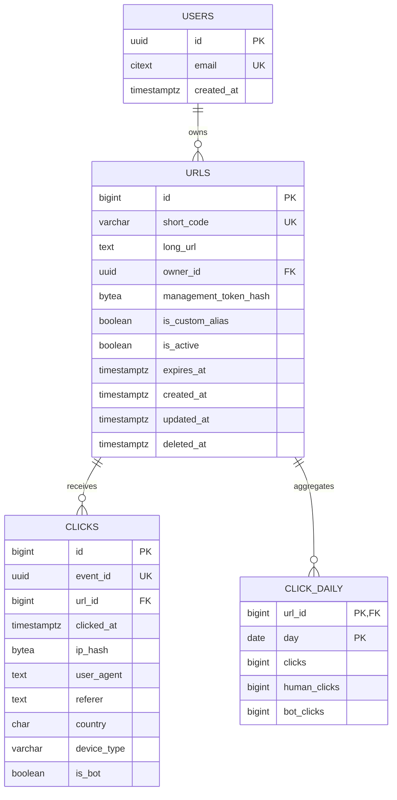

# Data Model

Status: target design · Database: Neon Postgres 16+ · Migrations: Alembic

## Entity relationship diagram



`USERS` is not used in v1. It is shown because `URLS.owner_id` is designed to accept account ownership without a destructive migration.

## Tables

### `urls`

| Column | Type | Constraints | Notes |
| --- | --- | --- | --- |
| `id` | `bigint` | PK, identity | Internal only; never exposed as the short code |
| `short_code` | `varchar(32)` | unique, not null, format check | Generated 7-char Base62 or custom alias |
| `long_url` | `text` | not null, 1–8192 chars | Normalized absolute `http`/`https` URL |
| `owner_id` | `uuid` | null, FK → `users.id` | Populated when accounts arrive |
| `management_token_hash` | `bytea` | not null, 32 bytes | HMAC-SHA256 of the raw token |
| `is_custom_alias` | `boolean` | not null, default false | Distinguishes generated codes from aliases |
| `is_active` | `boolean` | not null, default true | Manual disable switch |
| `expires_at` | `timestamptz` | null | Null means no expiry |
| `created_at` | `timestamptz` | not null, default `now()` | UTC |
| `updated_at` | `timestamptz` | not null, default `now()` | Updated by the application on every mutation |
| `deleted_at` | `timestamptz` | null | Soft delete; alias stays reserved |

The `users` table is created first in the migration so the nullable foreign key can reference it.

```sql
CREATE TABLE urls (
    id                     BIGINT GENERATED ALWAYS AS IDENTITY PRIMARY KEY,
    short_code             VARCHAR(32) NOT NULL,
    long_url               TEXT NOT NULL,
    owner_id               UUID REFERENCES users (id) ON DELETE SET NULL,
    management_token_hash  BYTEA NOT NULL,
    is_custom_alias        BOOLEAN NOT NULL DEFAULT FALSE,
    is_active              BOOLEAN NOT NULL DEFAULT TRUE,
    expires_at             TIMESTAMPTZ,
    created_at             TIMESTAMPTZ NOT NULL DEFAULT now(),
    updated_at             TIMESTAMPTZ NOT NULL DEFAULT now(),
    deleted_at             TIMESTAMPTZ,
    CONSTRAINT urls_short_code_uq UNIQUE (short_code),
    CONSTRAINT urls_long_url_len CHECK (char_length(long_url) BETWEEN 1 AND 8192),
    CONSTRAINT urls_short_code_format CHECK (short_code ~ '^[A-Za-z0-9_-]{3,32}$'),
    CONSTRAINT urls_token_hash_len CHECK (octet_length(management_token_hash) = 32),
    CONSTRAINT urls_expiry_after_creation CHECK (expires_at IS NULL OR expires_at > created_at)
);

CREATE INDEX urls_owner_created_idx
    ON urls (owner_id, created_at DESC)
    WHERE owner_id IS NOT NULL;

CREATE INDEX urls_active_expiry_idx
    ON urls (expires_at)
    WHERE is_active AND expires_at IS NOT NULL;
```

The unique constraint is the correctness boundary for code allocation. Services rely on it instead of pre-checking for existence, which would race under concurrency.

### `clicks`

Raw click events. Written by the analytics drain, never on the redirect request path.

| Column | Type | Constraints | Notes |
| --- | --- | --- | --- |
| `id` | `bigint` | PK, identity | Insert order |
| `event_id` | `uuid` | unique, not null | Idempotency key generated at redirect time |
| `url_id` | `bigint` | not null, FK → `urls.id` | Cascades on hard delete |
| `clicked_at` | `timestamptz` | not null | Event time, UTC |
| `ip_hash` | `bytea` | null | 16 bytes, keyed hash; never the raw IP |
| `user_agent` | `text` | null, ≤ 512 chars | Truncated |
| `referer` | `text` | null, ≤ 2048 chars | Origin + path only; query and fragment stripped |
| `country` | `char(2)` | null | ISO 3166-1 alpha-2 from Vercel geo headers |
| `device_type` | `varchar(16)` | null | `desktop`, `mobile`, `tablet`, `bot`, `unknown` |
| `is_bot` | `boolean` | not null, default false | Classifier result |

```sql
CREATE TABLE clicks (
    id           BIGINT GENERATED ALWAYS AS IDENTITY PRIMARY KEY,
    event_id     UUID NOT NULL UNIQUE,
    url_id       BIGINT NOT NULL REFERENCES urls (id) ON DELETE CASCADE,
    clicked_at   TIMESTAMPTZ NOT NULL,
    ip_hash      BYTEA,
    user_agent   TEXT,
    referer      TEXT,
    country      CHAR(2),
    device_type  VARCHAR(16),
    is_bot       BOOLEAN NOT NULL DEFAULT FALSE,
    CONSTRAINT clicks_ua_len CHECK (user_agent IS NULL OR char_length(user_agent) <= 512),
    CONSTRAINT clicks_referer_len CHECK (referer IS NULL OR char_length(referer) <= 2048),
    CONSTRAINT clicks_ip_hash_len CHECK (ip_hash IS NULL OR octet_length(ip_hash) = 16),
    CONSTRAINT clicks_device_type CHECK (
        device_type IS NULL OR device_type IN ('desktop', 'mobile', 'tablet', 'bot', 'unknown')
    )
);

CREATE INDEX clicks_url_clicked_idx ON clicks (url_id, clicked_at DESC);
CREATE INDEX clicks_clicked_idx ON clicks (clicked_at);
```

`event_id` uniqueness makes the drain idempotent: replaying a batch cannot duplicate a click. `ON DELETE CASCADE` is only relevant for hard deletes, which v1 does not perform.

### `click_daily`

Pre-aggregated daily counts. Read by the analytics API for completed days.

| Column | Type | Constraints |
| --- | --- | --- |
| `url_id` | `bigint` | PK, FK → `urls.id` |
| `day` | `date` | PK, UTC calendar day |
| `clicks` | `bigint` | not null, default 0 |
| `human_clicks` | `bigint` | not null, default 0 |
| `bot_clicks` | `bigint` | not null, default 0 |

```sql
CREATE TABLE click_daily (
    url_id        BIGINT NOT NULL REFERENCES urls (id) ON DELETE CASCADE,
    day           DATE NOT NULL,
    clicks        BIGINT NOT NULL DEFAULT 0,
    human_clicks  BIGINT NOT NULL DEFAULT 0,
    bot_clicks    BIGINT NOT NULL DEFAULT 0,
    PRIMARY KEY (url_id, day)
);
```

Rollups are recomputed from raw events for affected `(url_id, day)` pairs after each drain. Recomputing, rather than incrementing, keeps retries idempotent.

### `users` (future)

```sql
CREATE EXTENSION IF NOT EXISTS citext;

CREATE TABLE users (
    id          UUID PRIMARY KEY,
    email       CITEXT NOT NULL UNIQUE,
    created_at  TIMESTAMPTZ NOT NULL DEFAULT now()
);
```

When accounts ship, `urls.owner_id` is populated for authenticated creates. Anonymous links keep `owner_id = NULL`. No backfill is required.

## Invariants

1. `short_code` is globally unique, including soft-deleted rows.
2. A code is either generated (exactly 7 Base62 characters) or a custom alias (lowercase, 3–32 characters).
3. Raw management tokens are never stored or logged.
4. A redirect is allowed only when `is_active`, `deleted_at IS NULL`, and `expires_at IS NULL OR expires_at > now()`.
5. Every click belongs to an existing URL.
6. `event_id` is unique across all clicks.
7. All timestamps are stored in UTC.
8. Analytics read models are derived; they can be rebuilt from `clicks` while raw events are retained.

## Access patterns

| Operation | Query shape | Index |
| --- | --- | --- |
| Resolve redirect | `WHERE short_code = $1 AND deleted_at IS NULL` | `urls_short_code_uq` |
| Fetch managed link | `WHERE short_code = $1` | `urls_short_code_uq` |
| List future account links | `WHERE owner_id = $1 ORDER BY created_at DESC` | `urls_owner_created_idx` |
| Expiry cleanup | `WHERE is_active AND expires_at < now()` | `urls_active_expiry_idx` |
| Recent raw analytics | `WHERE url_id = $1 AND clicked_at >= $2` | `clicks_url_clicked_idx` |
| Retention delete | `WHERE clicked_at < now() - interval '90 days'` in batches | `clicks_clicked_idx` |
| Daily analytics | `WHERE url_id = $1 AND day BETWEEN $2 AND $3` | primary key |

## Data lifecycle

| Data | Retention | Mechanism |
| --- | --- | --- |
| Active links | Indefinite | — |
| Expired links | Kept, redirects return `410` | Daily cleanup may set `is_active = false` after a grace period |
| Deleted links | Metadata and analytics retained | Soft delete; alias remains reserved |
| Raw clicks | 90 days | Batched `DELETE` from the cleanup job |
| Daily rollups | 2 years | Cleanup job |
| Stream entries | Until acknowledged | `MAXLEN ~ 1,000,000` safety cap |
| Idempotency responses | 24 hours | Redis TTL |

Deleting a link does not erase analytics immediately. A future account-level "delete my data" flow will hard-delete rows and cascade clicks.

## Growth and partitioning

Initial sizing:

- 1 million links ≈ 300–500 MB with indexes and tokens.
- 10 million clicks ≈ 1.5–2.5 GB with indexes.
- 1 million links × 30 days of rollups ≈ 30 million small rows.

Plan:

- Keep `clicks` as a single table until roughly 50 million rows or 20 GB.
- Partition `clicks` monthly by `clicked_at` when that threshold is near. The redirect path never queries the full history.
- `click_daily` remains unpartitioned; it grows linearly with links × active days.
- Use Neon autoscaling and monitor index bloat with `pg_stat_user_indexes`.

## Migrations

- Alembic is the only schema change mechanism. No application-side `CREATE TABLE`.
- Use expand/contract for zero-downtime changes:
  1. Add nullable columns or new tables.
  2. Backfill in bounded batches.
  3. Switch reads and writes.
  4. Remove old structures in a later release.
- Migrations run in CI against a disposable database and in a dedicated deploy job against Neon. They never run on function cold start.
- Every migration must be reversible or have a documented forward fix.
- Preview deployments use separate Neon branches and never migrate production.

## Data integrity checks

- `alembic check` in CI detects model/migration drift.
- Integration tests assert unique-conflict behavior for codes and idempotent ingestion for clicks.
- Nightly job compares `click_daily` totals with raw counts for the last 7 days and alerts on drift.
