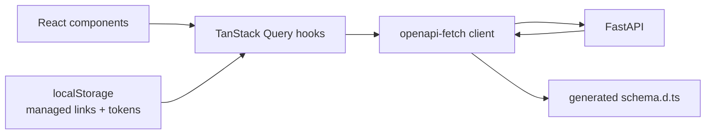

# Frontend Architecture

Status: target design · Stack: Bun, Vite 8, React 19, TypeScript 6, Tailwind v4, shadcn/ui

## Product surface

The web app is a static single-page application with three primary experiences:

1. **Create** — paste a URL, optionally set a custom alias and expiry, get a short link.
2. **Manage** — copy the link, keep a local list of links created on this browser, edit or delete with a management token.
3. **Understand** — view click totals and a daily series for a link.

The app is anonymous in v1. It does not have sign-in, a global account dashboard, or team features.

## Why a static SPA

- The API is the only backend; there is no server-rendered content.
- Vercel's CDN serves immutable assets with low latency and near-zero compute.
- The app does not need SEO beyond a marketing landing page; short links are not indexed.
- React 19 + Vite + Bun gives a fast local loop and a small operational surface.

Tradeoffs:

- Initial JS must be paid before the first interaction; route splitting and a lean dependency set control that.
- Viewer-specific data requires client-side fetching; TanStack Query handles caching and retries.
- No server-side secrets; management tokens live in the browser.

## Stack

| Concern | Choice | Notes |
| --- | --- | --- |
| Runtime/package manager | Bun 1.4 | `bun.lock` committed; Vercel builds with Bun |
| Build | Vite 8 | Static output in `dist/` |
| UI | React 19 + TypeScript 6 | Strict TypeScript |
| Routing | React Router v7 (library mode) | Lazy route modules |
| Server state | TanStack Query v5 | Cache, dedupe, retries, invalidation |
| Forms | React Hook Form + Zod | Shared validation schema client-side |
| Styling | Tailwind CSS v4 + shadcn/ui | CSS-first config, accessible primitives |
| Icons | lucide-react | Tree-shakeable imports |
| Charts | Recharts (via shadcn chart) | Lazy-loaded with the analytics route |
| Toasts | sonner | Copy/save feedback |
| API types | openapi-typescript + openapi-fetch | Generated from the FastAPI schema |
| Lint/test | oxlint, Vitest, Testing Library, Playwright | Fast local checks plus E2E |

Add dependencies only when the feature that needs them lands. The current scaffold has only React and Vite.

## Target folder structure

```text
urlshortner/
├── src/
│   ├── main.tsx
│   ├── app/
│   │   ├── app.tsx
│   │   ├── providers.tsx          # QueryClient, theme, router, toaster
│   │   ├── router.tsx             # route table + lazy imports
│   │   └── error-boundary.tsx
│   ├── pages/
│   │   ├── home-page.tsx
│   │   ├── link-analytics-page.tsx
│   │   └── not-found-page.tsx
│   ├── features/
│   │   ├── create-link/
│   │   │   ├── components/
│   │   │   │   ├── create-link-form.tsx
│   │   │   │   └── link-result-card.tsx
│   │   │   └── hooks/use-create-link.ts
│   │   ├── recent-links/
│   │   │   ├── components/recent-links.tsx
│   │   │   └── hooks/use-managed-links.ts
│   │   └── link-analytics/
│   │       ├── components/analytics-summary.tsx
│   │       ├── components/clicks-chart.tsx
│   │       └── hooks/use-link-analytics.ts
│   ├── shared/
│   │   ├── api/
│   │   │   ├── client.ts          # openapi-fetch instance + middleware
│   │   │   ├── errors.ts          # Problem Details normalization
│   │   │   ├── query-keys.ts
│   │   │   └── schema.d.ts        # generated; do not edit
│   │   ├── components/ui/         # shadcn components
│   │   ├── lib/
│   │   │   ├── env.ts
│   │   │   ├── format.ts
│   │   │   ├── storage.ts
│   │   │   └── utils.ts
│   │   └── styles/index.css
│   └── vite-env.d.ts
├── tests/
│   ├── unit/
│   └── e2e/
├── package.json
├── bun.lock
├── vite.config.ts
└── vercel.json
```

The current app has `src/App.tsx`, `src/main.tsx`, and boilerplate CSS. It is reorganized when the first feature lands.

## Routing

| Route | Page | Loading |
| --- | --- | --- |
| `/` | Create + recent links | Eager |
| `/links/:code` | Analytics and management | Lazy |
| `*` | Not found | Eager |

- Use a route-level error boundary and a Suspense fallback.
- Unknown routes render a real 404 page, not a redirect.
- Analytics date range is stored in search params (`?from=...&to=...`) so views are shareable and back/forward works.
- Do not put management tokens in URLs; they are read from local storage or entered explicitly.

## Data flow



- Components never call `fetch` directly.
- Query hooks own fetching, caching, and error normalization.
- UI state (open/closed, active tab) stays local; server state stays in Query.
- Local storage is a side channel for anonymous ownership, not a source of truth for link metadata.

## State categories

| State | Owner | Examples |
| --- | --- | --- |
| Server state | TanStack Query | Link metadata, analytics |
| URL state | React Router | `code`, date range |
| Form state | React Hook Form | URL, alias, expiry |
| Local persistence | `localStorage` | Management tokens, recent codes |
| Ephemeral UI | `useState` / context | Dialog visibility, theme, toasts |

There is no Redux or Zustand in v1. Adding a global store would duplicate state that Query and the router already own.

## API client

- `openapi-fetch` is created once with `VITE_API_BASE_URL`.
- A middleware adds `X-Request-ID` and `X-Management-Token` when supplied.
- Errors are converted to a discriminated `ApiProblem` type:

```ts
type ApiProblem = {
  status: number;
  code: string;
  title: string;
  detail: string;
  requestId?: string;
};
```

- The client never throws raw `Response` objects into components.
- Generated types are produced from the backend's OpenAPI schema; see [data-fetching.md](data-fetching.md).

## Error handling and resilience

- Root and route error boundaries catch render failures.
- Query errors render inline error states with a retry action and the request ID.
- Network requests use `AbortController` timeouts (10 s default).
- GET requests retry twice with exponential backoff on network errors and 5xx.
- Mutations do not retry unless they are idempotent. Create is retried only with the same `Idempotency-Key`.
- A missing or rejected management token renders a "paste your token" recovery form, not a dead end.
- Offline or API-down states explain what happened and preserve the user's input.

## Security

- No secrets in the bundle; every `VITE_*` variable is public.
- Management tokens are stored only in the browser. They are readable by any script on the origin, so XSS prevention is critical.
- Never render user URLs with `dangerouslySetInnerHTML`.
- Enforce a strict CSP via Vercel headers.
- Validate URLs client-side for UX, but treat server validation as authoritative.
- Use `rel="noopener noreferrer"` for external links.
- Do not log tokens or full URLs to analytics or error reporting.

## Accessibility and performance

- Every interactive element is keyboard reachable with a visible focus state.
- Forms use associated labels, descriptions, and `aria-describedby` for errors.
- Copy success is announced through an `aria-live` region.
- Color contrast meets WCAG 2.2 AA.
- The analytics route and chart library are lazy-loaded.
- Initial JS budget and Web Vitals targets are defined in [performance.md](performance.md).

## Testing strategy

| Level | Scope | Tools |
| --- | --- | --- |
| Unit | Validation, formatting, error normalization, storage | Vitest |
| Component | Create flow, copy feedback, error/empty states | Testing Library + MSW |
| E2E | Create → copy → redirect → analytics | Playwright against a local API |
| Accessibility | Automated checks on primary routes | axe-core in Playwright |

CI runs `oxlint`, `tsc -b`, `vitest run`, and `bun run build`. E2E runs against a preview or local stack.

## Design boundaries

- The frontend does not know about Postgres, Redis, streams, or short-code generation rules beyond validation.
- The backend owns canonical URL validation, alias rules, expiry, and analytics semantics.
- Shared enums and response shapes come from generated OpenAPI types, not duplicated interfaces.
- UI copy explains outcomes ("Link created", "This link has expired") rather than exposing status codes.

## Implementation order

1. Add Tailwind v4, shadcn/ui, React Router, TanStack Query, and testing tools.
2. Build the app shell, providers, router, and design tokens.
3. Implement create + copy + recent links with generated API types.
4. Implement the analytics route and token recovery.
5. Add E2E, accessibility, CSP, and performance budgets.
6. Deploy the static build to Vercel.
