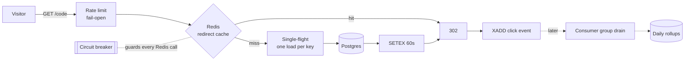

# System design showcase

Shortly is a URL shortener, but most of the code exists to make it behave well under load, during outages, and around untrusted input. The in-app **System design** page (`/system`) lists each technique with the file that implements it and, where possible, a live signal from the running API instance. This document is the written version of that page.

Live numbers come from `GET /api/v1/system/status`. They are per instance, kept in memory, and reset on a cold start. They show behavior; they are not a metrics pipeline, a benchmark, or a capacity claim. The same response carries a `config` block (code length and space, every rate limit, cache TTLs, breaker thresholds, analytics and retention settings) read from the running code, and the page fills its descriptions from it, so the numbers in the app never drift from the deployment. The tables below quote the defaults at the time of writing.

## Request path

## Performance

| Technique | How it works | Tradeoff | Code |
| --- | --- | --- | --- |
| Cache-aside redirect cache | A miss loads the link from Postgres and writes a small JSON entry with a 60 second TTL. Only live links are cached; edits and deletes evict the key. | Changes made elsewhere can take up to one TTL to land everywhere. | `backend/src/backend/api/routes/redirect.py` |
| Single-flight cache fills | The first request for a missing key becomes the leader and runs the load. Concurrent requests for the same key await its result, which prevents a cache stampede. | Coalescing is per process; each serverless instance still loads once. | `backend/src/backend/core/singleflight.py` |
| Analytics off the hot path | Each redirect appends one event to a Redis Stream. A consumer drains it in batches into Postgres later. | Charts are eventually consistent. | `backend/src/backend/services/analytics.py` |
| Daily rollups | Ingestion upserts `click_daily` counters keyed by `(url_id, day)` in a consistent order to avoid deadlocks. | Finer breakdowns need raw clicks, kept 90 days. | `backend/src/backend/services/analytics.py` |
| Cached top-links leaderboard | The ranking over daily rollups is cached per workspace for 60 seconds, behind single-flight. | Rankings lag by up to a minute plus queued events. | `backend/src/backend/services/leaderboard.py` |
| Random base62 codes | Five CSPRNG base62 characters (~916 million codes). A unique index catches collisions; creation retries up to five times. | Codes are unguessable but unordered. | `backend/src/backend/core/security.py` |

## Reliability

| Technique | How it works | Tradeoff | Code |
| --- | --- | --- | --- |
| Circuit breaker on Redis | Five consecutive transport failures open the circuit for 15 seconds. Then one trial call is allowed: success closes it, failure reopens it. Command errors do not count, because Redis answered. | While open, caching is skipped and limiters apply their fail-open or fail-closed policy. | `backend/src/backend/core/breaker.py`, `backend/src/backend/core/redis.py` |
| Fail-open / fail-closed rate limits | A fixed-window counter (`INCR` + `EXPIRE NX` in one pipeline). Redirects fail open; sign-in and writes fail closed. | Fixed windows allow bursts at window edges. | `backend/src/backend/services/ratelimit.py` |
| Durable consumer group | `XREADGROUP`, ACK only after the Postgres commit, `XAUTOCLAIM` for stale messages, dead-letter stream for repeated failures. | At-least-once delivery, made safe by event-ID dedupe. | `backend/src/backend/services/analytics.py` |
| Idempotency keys | Each create carries an `Idempotency-Key`; the first response is stored encrypted and replayed for 24 hours. | Very late retries create new links. | `backend/src/backend/services/links.py` |
| Atomic guarded counters | One `UPDATE ... WHERE clicks_used < max_clicks` enforces visit limits under concurrency. | Limited links always hit Postgres for that check. | `backend/src/backend/services/links.py` |
| Drain on read | Opening analytics drains a bounded batch first, because the free plan only allows a daily cron. | The first view after a busy period is slower. | `backend/src/backend/api/routes/links.py` |
| Liveness and readiness | `/health` does no I/O; `/ready` runs `SELECT 1` and `PING`. | One instance at one moment. | `backend/src/backend/api/routes/health.py` |

## Data, security and product safety

| Technique | Summary | Code |
| --- | --- | --- |
| Workspaces with RBAC | `X-Workspace-Id` is resolved against membership on every request; owner > admin > member > viewer. | `backend/src/backend/api/deps.py` |
| Soft deletes | Deleted codes stay in the unique index and are never reissued. | `backend/src/backend/services/links.py` |
| Tiered retention | Raw clicks 90 days, rollups two years, deleted in batches of 1,000. | `backend/src/backend/services/analytics.py` |
| Argon2id and hashed tokens | Passwords use Argon2id; session tokens are SHA-256 hashes; management tokens are HMACs. | `backend/src/backend/core/security.py` |
| HKDF and AES-GCM | One secret is expanded into a token pepper and a replay-encryption key. | `backend/src/backend/core/security.py` |
| Origin checks | Cookie-authenticated writes must come from an allowed origin. | `backend/src/backend/api/deps.py` |
| Destination validation | Rejects private/reserved IPs, local names, blocked hosts and redirect loops. | `backend/src/backend/services/validation.py` |
| Problem details and request IDs | RFC 9457 errors; `X-Request-ID` in responses and JSON access logs. | `backend/src/backend/core/problems.py` |
| Peek | `/{code}+` previews the destination with offline risk checks and never counts a click. | `backend/src/backend/services/visitor_pages.py` |
| Link-previewer classification | Chat unfurlers do not consume visit limits; bots are tagged. | `backend/src/backend/services/links.py` |
| Live alias availability | Syntax and reserved words, then a redirect-cache probe, then one indexed lookup. Rate limited per IP. Creation still enforces uniqueness. | `backend/src/backend/services/links.py` |
| Privacy-first analytics | Referrer origin, country and device class only; no IP addresses. | `backend/src/backend/services/analytics.py` |

## Request tracer

The **Trace a real redirect** panel sends one of your links through the same code a visitor hits, step by step, and reports how long each step took on the server. `POST /api/v1/system/trace` with `{"code": "...", "cold": true}` runs:

1. the redirect rate limiter (in its own `trace:` bucket, so tracing cannot lock real visitors out),
2. an optional cache eviction when `cold` is true,
3. the Redis cache read,
4. on a miss, the single-flight leader election, the Postgres load and the cache fill,
5. the expiry check and, for limited links, a read-only visit-limit check.

The response lists each step with `ms`, an `outcome` (`hit`, `miss`, `leader`, `loaded`, `skipped`, ...) and a detail line, plus the response a visitor would get (`302`, `404` or `410` and the reason). It never appends a click event and never consumes a visit; the enqueue step is reported as `skipped`. **Cold vs warm** runs an evicting trace and then a cached one and shows the speedup. Traces are limited per user, and only links in the active workspace can be traced.

## Workspace dashboard

`/dashboard` shows every link in the workspace at once. `GET /api/v1/dashboard?days=7|30|90` drains a bounded batch of queued clicks first (when drain-on-read is enabled), then returns:

- totals and a zero-filled daily series from rollups, with the previous period of the same length and the relative change,
- referrer, country and device breakdowns from retained raw events,
- a status count with one status per link, in the order blocked, expired, used up, then active or paused,
- per-link health: clicks this and last period, last click time, visit-limit usage, and issues such as `expiring_soon` (within 7 days), `near_limit` (80% of visits used), `no_recent_clicks` (no clicks this period for links older than 7 days) and `serving_fallback`,
- the same ingestion freshness snapshot as link analytics.

The table is capped at 500 links, sorted by clicks.

## Endpoints added for the showcase

| Method | Path | Notes |
| --- | --- | --- |
| GET | `/api/v1/links/availability?alias=` | Public, rate limited per IP (fails open). Returns `available` and a `reason` of `invalid`, `reserved` or `taken`. Soft-deleted codes count as taken. |
| GET | `/api/v1/links/top?days=1\|7\|30&limit=1..10` | Workspace-scoped, cached briefly. Response includes `cached` and `ttl_seconds`. |
| GET | `/api/v1/system/status` | Requires a signed-in user. Dependency probes with latency, breaker state, cache hit ratio, single-flight leaders/shared counts, rate-limit outcomes, stream backlog and the `config` block. |
| POST | `/api/v1/system/trace` | Workspace-scoped, same-origin, rate limited per user. Traces one redirect with per-step timings; never counts a click. |
| GET | `/api/v1/dashboard?days=7\|30\|90` | Workspace-scoped. Totals with period-over-period change, series, breakdowns, status counts and per-link health. |

## QR studio

The QR studio (`/qr`) runs entirely in the browser; nothing is uploaded.

- **Styles:** square, rounded, dots, bars, diamond, dither (an ordered 3×3 dither that fades across the code), halftone (dots that shrink toward the edges) and ASCII (characters instead of shapes, from `#@%&`, `0 1` or the link's own code). Finder patterns can be square, rounded or circular.
- **Fonts:** sans, serif, mono, rounded and display, used for the center label and ASCII glyphs. Fonts are loaded before a raster export so the file matches the preview.
- **Scan safety:** a center label or logo, or any artistic style, raises error correction to level H. Low contrast, inverted colors, a thin quiet zone and artistic styles show warnings. Every style, eye and font combination decodes with Chrome's built-in `BarcodeDetector` at 600 px, but test-scan prints anyway.
- **Export:** PNG, JPEG, WebP, SVG, a print-ready PDF (fit-to-code, A4 or Letter; the image is rendered for 600 DPI at the chosen size, with an optional caption) and text art. The preview can be copied as an image, as SVG markup, as text art, or as the link itself.
- **Bulk:** selecting several links produces one ZIP in any of those formats, built in the browser with stored entries.

Each link's detail page also shows its QR code with a PNG download and a link into the studio.
